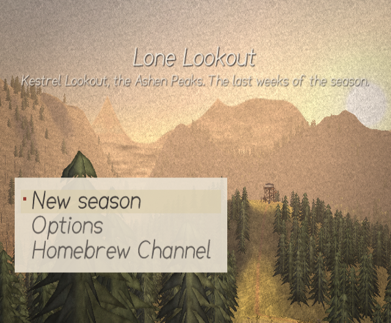

# Lone Lookout

A quiet first-person exploration game for the **Nintendo Wii** (Homebrew Channel). You spend the
end of a fire season as the lookout on Kestrel Knob in the fictional **Ashen Peaks**: walk, look,
listen, sit, and talk on the radio with Dot at Basin Station. No combat, no timers, no fail states.
Eleven in-game days, with a story path of about 4–6 hours.

**1.2: A season worth keeping.** Eight destinations with optional map pins, eight
keepsakes to discover by watching and listening, a field guide, a readable radio history,
automatic saves between calls, an in-game control guide, and a cleaner picture with subtle
pollen, autumn leaves, fireflies and dawn mist. Existing 1.0/1.1 seasons still load.



*Above: the title screen, Augie's bench on Cinder Ridge at golden hour, running in Dolphin at the
Wii's native resolution. More in [`docs/devlog/phase5.md`](docs/devlog/phase5.md).*

## Status

| Phase | | |
|---|---|---|
| 1 · Concept & design | ✅ | [`docs/DESIGN.md`](docs/DESIGN.md) |
| 2 · Prototype (walk/look, radio v0, test area) | ✅ | [`docs/devlog/phase2.md`](docs/devlog/phase2.md) |
| 3 · World building (the full map, interiors, days, weather, notebook) | ✅ | [`docs/devlog/phase3.md`](docs/devlog/phase3.md) |
| 4 · Narrative & audio (the radio script, duties, sound log, music) | ✅ | [`docs/devlog/phase4.md`](docs/devlog/phase4.md) |
| 5 · Polish & Dolphin testing (saves, menus, options, performance, the test matrix, packaging) | ✅ | [`docs/devlog/phase5.md`](docs/devlog/phase5.md) |

## Building

You need **devkitPro** with the Wii packages, and **Python 3** with numpy and Pillow for the
asset generators:

```sh
# https://devkitpro.org/wiki/Getting_Started
dkp-pacman -S wii-dev
pip install numpy pillow

make            # generates gen/ assets, builds lonelookout.dol
make package    # dist/apps/lonelookout/{boot.dol, meta.xml, icon.png}
make test       # host-side logic tests (any C compiler; no Wii toolchain needed)
```

Every texture, the font, the icon and all sound are generated by tools in this repo. There are
no binary assets to download.

## Running

**On a Wii:** unzip `dist/lonelookout-1.2.zip` to the root of the SD card (it holds
`apps/lonelookout/boot.dol`, `meta.xml` and `icon.png`) and launch *Lone Lookout* from the
Homebrew Channel. (Or `make run` to send it over the network with `wiiload`; saves still need
the SD card.) It runs in 480i, 480p (with component cables and progressive scan on), PAL 50 Hz
and PAL 60, in 4:3 or 16:9 as set in the Wii's settings.

**In Dolphin:** open `lonelookout.dol`. Recommended settings:

- *Controllers*: emulate a Wii Remote with a **Nunchuk** extension. Map the pointer to the
  mouse, the Nunchuk stick to WASD, A/B to the mouse buttons, and Z/C to Shift/Ctrl.
- *Graphics → Enhancements*: **untick "Disable Copy Filter"** (Dolphin ticks it by default).
  The game uses the copy filter for its soft look.
- *Graphics*: native (1×) internal resolution looks closest to hardware.
- *Saves*: Dolphin's virtual SD card works. To see `save.dat` as a file, turn on *Config → Wii →
  SD Card → Automatically Sync with Folder*; Dolphin writes the folder back when the game exits
  (use **Save and quit**).

## Controls

| Input | Action |
|---|---|
| Nunchuk stick | Walk (hold **Z** to stride) |
| Pointer | Look: turns only near the screen edges, eases to a stop if the pointer is lost |
| **A** | Interact (*Read*, *Sit*, *Sleep*, *Light*, *Brew*, *Sight*…), pick a radio choice, stand up |
| **B** | Answer the radio, or call Basin yourself · close the notebook or a note |
| Hold **C** | Listen: the world quietens and nearby sounds get labels; stay on one for 3 s to write it down |
| Seated, hold **Z** | Let time pass (without a Nunchuk: hold D-pad ↓) |
| D-pad ↑ | Binoculars (once you've taken them from the hook by the cab door) |
| D-pad ↓ | Notebook (Today, Map, Notes, Radio, Sounds): ←/→ turn pages, ↑/↓ and **A** to reread a note |
| D-pad ←/→ | Snap turn 30° |
| Without a Nunchuk | D-pad ↑/↓ walk, ←/→ turn, **1** binoculars, **2** notebook, hold **−** listen; seated, hold D-pad ↓ to let time pass |
| **HOME** or **+** | Pause (time stops): Resume, Options, Save and return to the title, Save and quit |
| Hold **1 + 2** | Developer overlay (frame time, position, state, mixer stats, triangles, video mode) |

The title screen has **Continue** (with the saved day and time), **New season**, **Options** and
**How to play**, plus **Homebrew Channel**. **HOME** on the title returns to the Homebrew Channel.

You arrive at the trailhead on Day 1 at 15:30. The tower is up the trail to the north. Each day
there are weather readings to take at the shelter on the catwalk (one before noon, one after
five) and an errand from Dot; the notebook's **Today** page keeps track and says what's next. Once
the day's work is done, the rest of the day is yours: wander, or sit and let time pass. The cot
lets you sleep from 19:00, and each morning is a new day. On the last evening, the road gate is
the way out, and the closing card remembers a few of the things you did.

### Places and things worth keeping

The notebook has **Places** and **Moments** pages alongside Today, Map, Notes, Radio and Sounds.
Places gives a short invitation to each of eight stops, with notes about the best time to visit.
On Places or Map, **up/down** selects a destination and **A** pins or unpins it. A pinned stop
adds a bearing and straight-line distance to the view. Follow the trails around steep ground;
the marker is a compass bearing, not a walking route.

Moments holds eight optional keepsakes. Listen on the dock at dawn, watch the fawns through
binoculars, read Augie's flower book, sit on the ridge at sunset, hear the burn, shelter through
the dry storm, listen to the first rain, or find the quiet after dark. Each page gives a gentle
hint before you find it, then Theo's own words and the day you kept it. Nothing is required to
finish the season. Places, pins and keepsakes survive saving and continuing.

**Radio history:** up/down scrolls earlier and later entries. **Options → Conversation pace →
Press A** lets each spoken line finish and waits for you to advance. Film grain is optional and
off by default. **How to play** is available from both title and pause menus.

### Saves and options

The game saves to `SD:/apps/lonelookout/save.dat` when you go to sleep and when you choose
**Save and quit** or **Save and return to the title**. A save holds the day and time, where you
are, what you've found, written and logged, the radio log and the radio script's progress, and
your options. It is versioned and checksummed, so a damaged file is ignored rather than loaded.
Without an SD card the game still plays, and the title says the season won't be saved.
The game also autosaves about every 90 seconds while walking or sitting between calls. A small
message confirms the save. If a manual save fails, the pause menu stays open so you can retry.
Back up `save.dat` before trying a new build, and use Save and quit before removing the card.

**Options:** look sensitivity, comfort-box size, invert look, snap turn, head sway, walk bob,
compass, larger subtitles, subtitle backing, the hearing effect (Theo's bad left ear while
listening), mono, three volumes (sounds of the world, the radio, music), a 30 fps lock and the
playtest log.

### Voices (optional)

The radio voices are a "murmur" synthesiser by default, with subtitles. Any line can be replaced
by a recording: `SD:/apps/lonelookout/vo/<LINE_ID>.pcm` (raw 16-bit little-endian mono,
22,050 Hz). The build lists every line ID with its speaker and text in `gen/vo_lines.txt`
(e.g. `D7_SEVEN_03	DOT	...Go on.`); a line without a file keeps the murmur.

**Generating them with ElevenLabs.** `tools/voice/generate_vo.py` voices the whole script with
[ElevenLabs](https://elevenlabs.io) text to speech, cast from `data/voices.json` (Dot, Theo
and the Harrow crew, matched to the character notes in the design):

Only **Python 3's standard library** is needed for the voice tool. It prepares its own dialogue
list, so no Wii compiler, numpy, Pillow or full asset build is required:

```sh
python3 tools/voice/generate_vo.py --plan         # works offline before creating an API key
export ELEVENLABS_API_KEY=...                     # account key with TTS, Voices, User and Models access
python3 tools/voice/generate_vo.py --plan         # checks casting, remaining allowance and model rate
python3 tools/voice/generate_vo.py --sample       # a few lines per speaker: voices/samples/*.wav
python3 tools/voice/generate_vo.py --list-voices  # recast in data/voices.json if you like
python3 tools/voice/generate_vo.py --calls D1_ARRIVE --budget 1000 # try the opening conversation
python3 tools/voice/generate_vo.py                # continue with as much as the allowance permits
python3 tools/voice/generate_vo.py --pack         # dist/lonelookout-1.2-voices.zip, no compiler or key
```

On Windows PowerShell, use `$env:ELEVENLABS_API_KEY="your key"` and `python` in place of
`python3`. Samples consume allowance; `--budget` applies to samples as well as full generation.
The game reports the number of recorded lines it found at the bottom of **Options**.

The script is 505 lines, about 24,000 characters (the 20 lines that read out live values stay
murmured). It voices whole calls in story order and never starts a call it can't finish, so a
partial set never switches voices mid-conversation; run it again when your credits renew and it
carries on where it stopped. Check the allowance and rate for your own ElevenLabs account;
the tool's plan is an estimate. Unzip the voices zip to the SD card's root next to the game,
then restart. Keep `voices/manifest.json` with your local recordings so resuming can skip lines
already generated. The pack includes an ElevenLabs attribution marker for the game credits.
If your account requires MP3 output, install ffmpeg for conversion. Check ElevenLabs' current
terms for your intended use.

### Playtesting

Turn on **Options → Playtest log (SD card)** and the game keeps a log at
`SD:/apps/lonelookout/playtest.log`: each day's real time, the calls (how long they rang, which
were missed, the choices), where the player stood still for half a minute or more, time-lapses,
what they used, and how each sitting ended. Nothing leaves the card. Collect one log per tester,
then:

```sh
python3 tools/playtest/summarise.py alice.log bob.log > report.md
```

## Development builds

| Command | What it is |
|---|---|
| `make SHOTS=1` | `lonelookout_shots.dol`: a scripted screenshot tour (fixed camera poses, no input) |
| `make WALKTEST=1` | `lonelookout_walktest.dol`: synthetic Remote + Nunchuk input that walks, turns, answers the radio, calls Basin and pages through the notebook, for automated checks in Dolphin |
| `make REMOTETEST=1` | `lonelookout_remotetest.dol`: the same walk test with no Nunchuk (the Remote-only controls) |
| `make MENUTEST=1` | `lonelookout_menutest.dol`: scripted title, pause and Options menus, save, return to the title, Continue, Save and quit |
| `make PERF=1` | `lonelookout_perf.dol`: the worst views for the frame budget, with the triangle counts on screen |
| `make SOAK=1` | `lonelookout_soak.dol`: an hour of Day 11 with music back to back, calls and Listen, presenting one frame every 10 s with the mixer stats |
| `make SOAKRIDGE=1` | `lonelookout_soakridge.dol`: the time-lapse soak, seated on Augie's bench holding Z with days cycling |
| `tools/capture/capture_shots.sh <dir>` | Builds the tour, runs it in headless Dolphin and keeps one frame per shot |
| `tools/capture/soak.sh <dir>` | Runs the audio soak in headless Dolphin and keeps a frame a minute (`SOAK_VARIANT=ridge` for the ridge soak) |
| `tools/voice/generate_vo.py` | Voices the radio script with ElevenLabs (see *Voices* above) |
| `tools/playtest/summarise.py <logs>` | Turns playtest logs into a report |
| `tools/test/matrix.sh <dir>` | The Dolphin test matrix: 480p, 480i, PAL 50, PAL 60, 16:9, no Nunchuk, with and without an SD card, the menus and saves, the worst views |

## Repository layout

```
src/        game code (C99, libogc): core/ gfx/ input/ world/ game/ audio/
tools/      Python generators: assets/ (textures, icon), font/ (Lookout Hand),
            worldgen/ (the Ashen Peaks map and its baker), dialogue/ (the .lls compiler),
            music/ (the score compiler), concept/ (design renders), capture/, test/,
            voice/ (ElevenLabs voices), playtest/ (log reports)
data/       palette/ (colour script), dialogue/ (the radio script, .lls), music/ (six scores)
docs/       DESIGN.md, devlog/, screenshots/, concept/
tests/host/ host-side tests of pure game logic
hbc/        Homebrew Channel metadata
```

## Originality

Every asset is generated by tools in this repository: textures, models, the hand-lettered font,
music and sound effects. (The optional ElevenLabs voices are generated by you, with your key, and
stay on your SD card; they aren't part of the repository or the release.) The six pieces of music are written as note data in `data/music/` and
performed by the game's own synthesiser. No third-party game assets are used.
