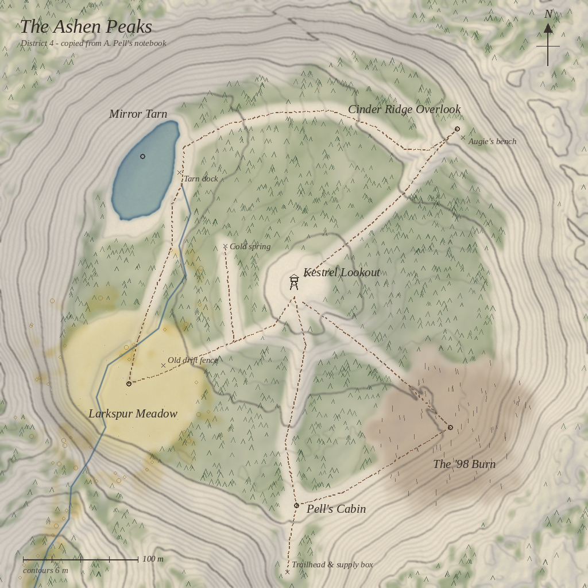
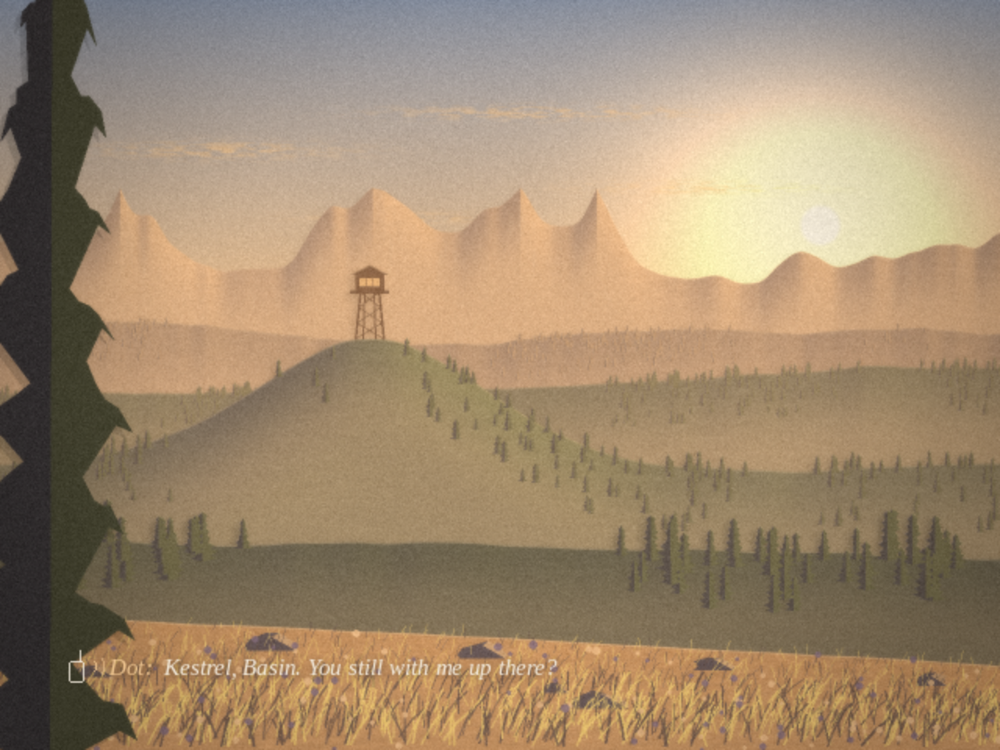
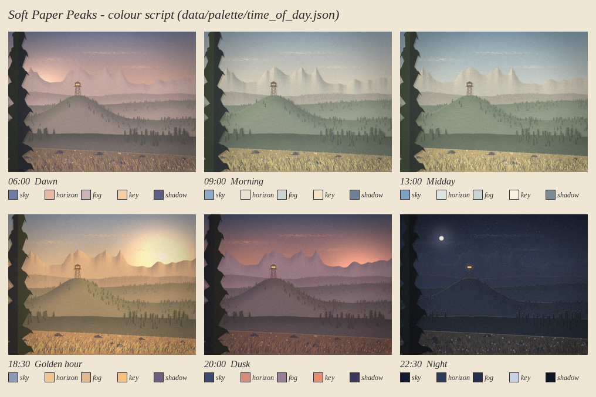
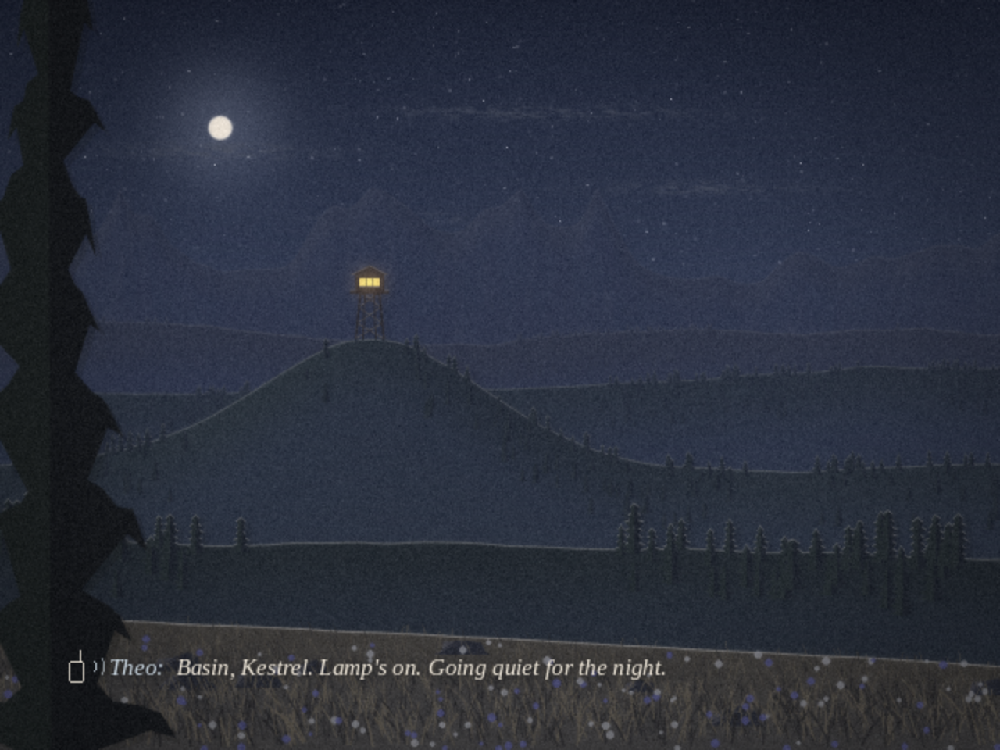

# Lone Lookout — Game Design Document

**Phase 1 of 5 · Concept & Design** · Target: Nintendo Wii (Homebrew Channel `.dol`) · Status: design approved → prototype next

> *A quiet first-person game about one late summer in a fire lookout. You walk, look,
> listen, and sit. Someone 40 km away talks to you on the radio. Then the rain comes.*

---

## Contents

0. [At a glance](#0-at-a-glance)
1. [Design pillars](#1-design-pillars)
2. [Story & characters](#2-story--characters)
3. [Day structure](#3-day-structure)
4. [Moment-to-moment play](#4-moment-to-moment-play)
5. [Controls](#5-controls)
6. [The world: Ashen Peaks](#6-the-world-ashen-peaks)
7. [Interactive objects, notes & sounds](#7-interactive-objects-notes--sounds)
8. [Radio conversation outline](#8-radio-conversation-outline)
9. [Art direction: "Soft Paper Peaks"](#9-art-direction-soft-paper-peaks)
10. [Audio direction](#10-audio-direction)
11. [Technical design](#11-technical-design)
12. [Scope control](#12-scope-control)
13. [Production plan (Phases 2–5)](#13-production-plan-phases-25)
14. [Risks](#14-risks)
15. [Repository layout](#15-repository-layout)

Concept images in [`docs/concept/`](concept/) are **design mock-ups rendered by our own Python
tools**, not in-engine or Dolphin screenshots. Real Dolphin captures start in Phase 2.

---

## 0. At a glance

| | |
|---|---|
| **Genre** | First-person walking / exploration, narrative-optional |
| **Player** | Theo Marsh, new fire lookout at Kestrel Lookout (radio call sign *Kestrel*) |
| **Voice on the radio** | Dot Amsel, district dispatcher at Basin Station (*Basin*) |
| **Setting** | The Ashen Peaks, a fictional mountain range; last month of fire season |
| **Length** | Story path 60–90 min · wanderer 2–3 h · no time limit, no fail states |
| **Scope** | 1 map (512 × 512 m) · 6 areas · 7 days · ~28 radio calls · 12 notes · 12 sounds · 1 tower interior |
| **Platform** | Original Wii, `.dol` from the Homebrew Channel; tested in Dolphin first |
| **Tech** | C99, devkitPPC + libogc (GX, WPAD, ASND, LWP) + libfat; Python 3 asset tools |
| **Frame rate** | 60 fps in Dolphin; adaptive lock to a steady 30 fps on hardware |
| **Controls** | Wii Remote + Nunchuk: pointer looks, stick walks, B raises the radio |
| **Assets** | 100 % original and generated by tools in this repo (textures, models, font, music, SFX) |

---

## 1. Design pillars

1. **Stillness is a verb.** Sitting, watching and listening are real actions with their own
   buttons, and they pay off. Sit on a bench and hold **Z** to watch the day go by.
2. **Listening is play.** Theo has lost most of the hearing in his left ear. **Listen** (hold **C**)
   is the core optional activity, and the story is about what it means to listen.
3. **The world keeps its own time.** Light, weather and season move on whether you watch or
   not. Nothing waits for you, and nothing punishes you.
4. **Handmade and finished.** Every pixel and every sound comes from tools we wrote. The scope is
   small on purpose so it can be polished.

**Rules that follow from the pillars**

- No HUD unless the player asked for it. At most one prompt on screen. The compass is off by default.
- No timers. Dialogue choices never time out; "[say nothing]" is always an explicit option.
- Nothing needs speed or precision. Walking speed caps at a stride, never a run.
- Every line of text can be re-read in the notebook's radio log.
- The story is fully optional: ignore the radio, sleep through the days, and the season still ends.

---

## 2. Story & characters

### Premise

It's late August in the Ashen Peaks, a dry range named for its pale volcanic scree. Augie Pell
spent twenty-two seasons as the lookout on Kestrel Knob and has just retired. Theo Marsh replaces
him for the last few weeks of the fire season. His only regular contact is Dot Amsel, who has run
radio dispatch at Basin Station, 40 km down the valley, for nineteen summers, on Channel 4.

Nothing goes wrong. Over seven days Theo and Dot work out why each of them chose to be this alone,
and both quietly decide to be a little less alone afterwards.

### Characters

**Theo Marsh** — *Kestrel* — 41. A piano tuner from the coastal city of Port Hallam. In February
he woke up with his left ear gone mostly quiet (sudden sensorineural hearing loss). It might come
back, or it might not. He has tuned pianos by ear for nineteen years. He took the lookout job the
week his audiologist said "give it time." He tells himself he came for the quiet. Really he wanted
a summer where nobody asks how his ear is.
*Personality:* dry, precise, apologises too much, notices small things, a bit formal on the radio
at first.
*Voice:* soft light baritone, unhurried, a smile in it. Clears his throat before saying anything
true.

**Dorothea "Dot" Amsel** — *Basin* — 63. Spent 24 years as a radio officer on cargo ships, then
19 seasons as district dispatcher. She's funny and bossy in a caring way. She speaks fluent radio
procedure and is just as fluent at deflecting. She has always been the voice that helps other
people, and she's bad at being the one who needs something. Her sister Ruth lives inland in Calder
and invites her every Christmas. Dot always says she's working.
*Voice:* warm alto with a little gravel, laughs mostly through her nose. Her radio cadence is
precise and loosens over the season.

**Augustin "Augie" Pell** — previous lookout, 74, now living with his daughter in the lowlands.
He's never heard on the radio. He appears only through notes, carvings and one postcard: kind,
wry, sentimental, and a terrible speller of bird names. He's alive and well. There is no twist.

### Why they chose isolation (revealed gently, Days 3–6)

| | On the surface | Underneath | Where they land (the hope) |
|---|---|---|---|
| **Theo** | "I wanted quiet." | He wants to escape sympathy, not grief. Secretly he wanted to *hear everything once more* while both ears still half-work. | Listening is attention, not acuity. Dot: *"You hear fine, Theo. You just hear slower now."* |
| **Dot** | "Land's too loud. On the radio nobody watches you figure out what to say." | Basin is being automated next spring. This is the last season anyone sits in her chair, and she hasn't told anyone. | She might try land for a while. Ruth has their mother's old upright piano that nobody has played since 2009. Theo offers to tune it. |

### What the story is not

There's no conspiracy, no missing person, no disaster and no twist. There's no romance arc either:
it's warmth and friendship, and players can read it how they like. The biggest "event" is a small
lightning smoke on Day 4. A ground crew handles it off-screen, and Dot says "nice catch."

### Ending

On Day 7 the first autumn rain ends the season. Theo can write on the last page of Augie's
logbook. Dot makes her last call from Basin. Afterwards the player can stay out in the rain as
long as they like. When they walk down to the trailhead gate, a prompt asks *"Leave the
mountain?"*. Confirming shows a closing card, *"Kestrel Lookout — closed for the season,"* and
credits drawn as notebook pages. Nobody meets on screen. It's left open.

---

## 3. Day structure

There are seven days, spread across the last four weeks of the season, so the land visibly turns
from late-summer green-gold to early-autumn amber. Each day runs from **06:00 → ~23:30**.
**1 in-game hour = 90 real seconds**, so a full day takes about 26 minutes if you never sit.
The cot unlocks sleep from 19:00. After 23:30 the night simply holds (stars, crickets) until you
sleep. There is no forced end.

| Day | Date | Weather | Season | Story beat (all optional) | Discoveries it nudges you toward |
|---|---|---|---|---|---|
| **1** *Channel Four* | 21 Aug | Clear, light haze | 0.00 | Arrive at the trailhead at 15:30 and walk up to the tower (the tutorial walk). First radio check. Dot explains the job: "You are paid to sit." | Welcome note, the singing stair, binoculars, Augie's map under the cot |
| **2** *Piano Man* | 22 Aug | Clear, warm | 0.05 | First real walk out. The doe and fawns. "What did you do before?" "I tune pianos." The wobble conversation. | Drift-fence note, cold spring |
| **3** *Say Again* | 23 Aug | High cloud, breezy | 0.10 | Supply drop at the gate. Wind garbles Dot at the tarn, and Theo snaps, then apologises. Pell's Cabin. | Dock tin & thermos, the cabin |
| **4** *Dry Lightning* | 28 Aug | Dry thunderstorm 14:00–17:30 | 0.30 | The one real "job": a lightning smoke on Harrow Ridge. Sight it with the fire finder and report a bearing. That night Theo can tell Dot about his ear. | The '98 Burn |
| **5** *Land's Too Loud* | 3 Sep | Orange haze from far-off fires | 0.50 | Augie's bench: "SIT HERE AT SEVEN." Augie described the sunset to Dot every night for 22 years. Theo describes it now. Dot's story of the ships. | Cinder Ridge |
| **6** *Last Season* | 10 Sep | Clear, cold; first gold aspens | 0.80 | A postcard from Augie in the supply box ("Is it F?"). Dot reveals Basin is closing, and talks about Ruth's piano. | Cabin: the resignation draft, pressed flowers |
| **7** *First Rain* | 15 Sep | Clouding over; rain from 12:00 | 1.00 | The last weather report. The logbook's last page. The last call. Leave when ready. | Rain on the tin roof |

**If the player ignores everything,** days still advance by sleeping, the rain still comes on
Day 7, and the gate still offers the ending. Nothing in the story is needed to finish.

**Season** (0→1) is a single scalar. It shifts grass and aspen tints, the angle of the light,
bird and insect activity, and the evening temperature in Dot's weather reports.

---

## 4. Moment-to-moment play

### Core verbs

| Verb | What it is | Why it matters |
|---|---|---|
| **Walk** | Analog stroll (max 2.2 m/s). Hold **Z** to stride (3.4 m/s). | Slow enough to notice things, fast enough never to feel like a chore. |
| **Look** | IR pointer with a "comfort box" (see §5). | Natural and precise; pointing at things *is* curiosity. |
| **Interact** | **A** on whatever the soft reticle is resting on. One-word handwritten label: *Read, Sit, Kettle…* | The single action button. |
| **Radio** | **B** raises or lowers the handset. Answer calls, or call Basin yourself. | The relationship. Calling unprompted gets a short check-in from a pool of ~60 lines. |
| **Listen** | Hold **C**. The world quietens and sounds near the reticle get handwritten labels. Hold 3 s to log a sound in the notebook. | Pillar 2. The gentle "collection" layer. |
| **Sit** | **A** on a sit spot (six of them). The camera lowers and look is limited to ±75°. | Pillar 1. |
| **Let time pass** | While sitting, hold **Z**: time runs ×30 (1 hour in 3 s). Release to stop. | A time-lapse of light, clouds and shadows. Stops by itself if the radio rings. |
| **Binoculars** | **D-pad ↑** once found. Pointer aims; **+/−** zoom 4×/8×. | Spot fawns, smoke, distant landmarks. |
| **Notebook** | **D-pad ↓**. Tabs: Map · Notes · Sounds · Radio log. | Memory, re-reading, accessibility. |

### A typical day

1. You wake on the cot at 06:00 to a title card (*Day 2 — 22 August*). The kettle's on. Dot gives
   her morning weather report: temperature, humidity, wind, fire danger.
2. You wander. Maybe the meadow for the fawns, the tarn to sit on the dock, or nowhere at all.
3. Place-based or time-based calls come in: you arrive somewhere, find something, or golden hour
   starts.
4. Golden hour. Many players head to a sit spot and let time pass.
5. Evening call. Back at the tower, the lamp goes on. Optionally a short night call.
6. You sleep. The day autosaves.

### Radio etiquette as a mechanic

When a call comes in, a soft two-tone chirp plays and the reticle shows a small radio glyph. Raise
the radio (**B**) to answer, whenever you like.

- If you leave it, Dot leaves a short message and tries again later (story calls) or lets it go
  (small talk). The call waits for you; nothing is lost because of time.
- Choices appear as up to three handwritten cards plus **[say nothing]**. Point at one and press
  **A**. None of them time out.

### Comfort & accessibility

- Snap-turn on D-pad ←/→ (30°) for players who find pointer turning uncomfortable.
- Head sway, walk bob and the hearing effect (§10) can each be switched off.
- Subtitles come in three sizes, with an optional soft backing panel.
- A mono audio option.
- A Wii-Remote-only fallback scheme (§5).

---

## 5. Controls

### Wii Remote + Nunchuk (default)

| Input | Action |
|---|---|
| **Nunchuk stick** | Walk (analog) |
| **Z** | Hold: stride · while seated: let time pass |
| **C** | Hold: Listen |
| **Pointer** | Look (comfort box) and aim the reticle |
| **A** | Interact · choose a dialogue card · sit / stand |
| **B** (trigger) | Raise / lower the radio |
| **D-pad ↑** | Binoculars (raise / lower) |
| **D-pad ↓** | Notebook |
| **D-pad ← / →** | Snap turn 30° (option) |
| **+** | Pause menu (Resume · Notebook · Options · Save & quit) |
| **−** | Compass on/off (off by default) · in binoculars: zoom out |
| **HOME** | Return to the Homebrew Channel (standard libogc behaviour) |
| **Remote tilt (roll)** | Subtle head sway, ±2.5° camera roll, low-pass filtered (option) |
| **1 + 2 (hold)** | Developer builds only: performance overlay |

### Pointer look — the "comfort box"

- The pointer moves a soft reticle freely inside a central box, 55 % of the screen wide and
  50 % tall, and the camera stays still.
- Outside the box, yaw speed ramps up smoothly from the box edge to the screen edge
  (`smoothstep(0.55, 0.95, |x|)`), up to **70°/s**. Pitch works the same way, up to **45°/s**,
  clamped to ±60°.
- When the pointer leaves the screen (IR lost), turning **eases to zero over 0.25 s**. That avoids
  the classic "camera spins away when you lower the remote" problem.
- IR position is smoothed with a 2-pole filter (~60 ms) to hide sensor-bar jitter.
- Options: sensitivity (5 steps), box size (S/M/L), invert pitch.

### Wii Remote only (no Nunchuk detected)

When no Nunchuk is detected, a small card says "*Connect a Nunchuk for the best experience,
or press A to continue*." The fallback scheme is: **D-pad ↑/↓** walk, **D-pad ←/→** turn (smooth),
**pointer** looks, **A** interact, **B** radio, **1** binoculars, **2** notebook, **hold −** listen.
There is no stride without the Nunchuk, because B stays reserved for the radio.

### Suggested Dolphin mapping (emulated Wii Remote + Nunchuk)

| Wii | Keyboard / mouse |
|---|---|
| Pointer | Mouse (Point: "Cursor" / relative input off) |
| A / B | Left / right mouse button |
| Nunchuk stick | W A S D |
| Z / C | Left Shift / Left Ctrl |
| D-pad | Arrow keys |
| + / − / HOME | Enter / Backspace / Esc… (any) |
| 1 / 2 | 1 / 2 |
| Tilt | Q / E (optional) |

---

## 6. The world: Ashen Peaks



*The map above is generated from the same data the game will bake its terrain from
(`tools/worldgen/ashen_peaks.py`). In the game it appears in the notebook as "copied from
A. Pell's notebook" once you find his map under the cot.*

### Scale & shape

- The playable area is **512 × 512 m**: a mountain bowl draining south-west. A heightmap of
  **129 × 129** samples at **4 m** spacing gives the low-to-mid-poly look.
- **Kestrel Knob** sits in the middle with the tower on top. **Cinder Ridge** runs along the NE
  rim. **Mirror Tarn** fills a basin in the NW. **Larkspur Meadow** is the flat SW floor.
  **The '98 Burn** covers the SE slope. **Pell's Cabin** sits in the south near the trailhead.
- Beyond the rim, four painted "backdrop rings" of distant ranges (out to ~3 km) make the bowl
  feel like part of a much bigger country.
- Trails total **1.48 km** in one big loop with three short spurs. You can never get stuck down a
  dead end. Every trail is graded into the hillside (a smoothed bed, ≤ 20° along most of its
  length, ≤ 28° on the scramble up to the ridge), so walking never hits a sudden steep step.

### The six areas

| # | Area | Elevation* | Character | Sit spot | Best time |
|---|---|---|---|---|---|
| 1 | **Kestrel Lookout** | 2,257 m | A 9 m timber tower with four flights of stairs, a catwalk and a 4 × 4 m glazed cab. Fire finder in the middle, cot, iron stove and kettle, radio table, lamp, logbook, Augie's shelf, and a wooden **lightning stool** with glass-insulator feet. A woodpile and cistern at the base. | Lightning stool; catwalk | Any; night with the lamp on |
| 2 | **Larkspur Meadow** | 2,214 m | A flat meadow of dry grass and purple larkspur. The creek meanders through, an old grey drift fence is half fallen, and aspens ring the edge. A doe and twin fawns graze at dawn. | Fallen log | Dawn, dusk (elk, Day 5+) |
| 3 | **Mirror Tarn** | 2,205 m (water) | A small alpine lake (~110 m) with still water that reflects the ridge and the distant ranges. There's a weathered dock with Augie's tin box, and an open shoreline of sedge and boulders. | End of the dock | Morning calm; night frogs |
| 4 | **Cinder Ridge Overlook** | 2,287 m | The highest point you can walk to. Dark cinder and pale ash scree (where the range gets its name), wind-bent whitebark pines, and Augie's carved bench. You can see everything from here. | Augie's bench | Golden hour ("SIT HERE AT SEVEN") |
| 5 | **The '98 Burn** | 2,221 m | A slope that burned 27 years ago: silver standing snags, pink fireweed, and dense knee-high lodgepole saplings growing back. Augie watched it burn from the tower. | A fallen snag | Morning (woodpecker), windy afternoons |
| 6 | **Pell's Cabin & Trailhead** | 2,215 m | A one-room 1950s survey cabin, Augie's "second office": a porch step, spoon wind-chimes, the pressed-flower book and the drawer with the old letter. A path runs south to the road gate and the bear-proof supply box. | Porch step | Afternoon |

\* Elevations are computed by the world generator (`--summary`); in-game they appear only on the notebook map.
Phase 3 lowered the knob and the ridge from the Phase 1 sketch (which had 70° trail sections) so
that every area is reachable on foot.

**Minor landmarks:** the cold spring (a pipe spring with a tin cup), the drift fence, the tarn
dock and Augie's bench.

### Getting around (walking times at a 2.2 m/s stroll)

| Route | Distance | Climb | Stroll |
|---|---|---|---|
| Tower → Meadow | 167 m | (43 m descent) | 1.3 min |
| Meadow → Tarn (and along the shore) | 214 m | (9 m descent) | 1.6 min |
| Tarn → Ridge (across the ridge's south-west face) | 260 m | 81 m | 2.0 min |
| Ridge → Tower | 188 m | 12 m (42 m descent) | 1.4 min |
| Tower → Cabin | 186 m | (43 m descent) | 1.4 min |
| Cabin → Burn | 151 m | 7 m | 1.1 min |
| Burn → Tower | 171 m | 38 m | 1.3 min |
| Cabin → Trailhead gate | 59 m | 20 m | 0.4 min |

The north loop (Tower → Meadow → Tarn → Ridge → Tower) is about 6.5 minutes. The south loop
(Tower → Cabin → Burn → Tower) is about 4 minutes. *(Computed from the baked trail profiles.)*

### Boundaries

The bowl's rim is the edge of the world. Slopes steeper than **38°** can't be entered (nor left
except downhill), so the player slides along the slope instead of hitting an invisible wall in
open country. The creek gorge to the SW is too steep to enter. The road out to the S is closed
by the gate, and a one-time thought subtitle explains it: *"That's the district line. Dot would
kill me."* The rim and the deep tarn have their own one-time thoughts. The gate is the exit for
the ending.

---

## 7. Interactive objects, notes & sounds

### Objects

| Object | Where | Interaction | Effect |
|---|---|---|---|
| **Radio** | Theo's belt (B) / handset on the tower table | Answer, call Basin | Story calls, check-ins |
| **Binoculars** | Hook by the tower door (Day 1) | D-pad ↑ | Zoom view with soft vignette; faint pencil labels on known landmarks |
| **Fire finder** | Centre of the tower cab | A → top-down sighting ring | Shows bearings to the six areas; reports the Day 4 smoke (bearing 104°) |
| **Lightning stool / catwalk / dock / bench / porch step / meadow log** | 6 sit spots | A to sit / stand | Sit; hold Z to let time pass |
| **Cot** | Tower | A (after 19:00) | Sleep → day card → autosave |
| **Kettle & stove** | Tower | A | Morning coffee ritual: steam, whistle, one line from Theo |
| **Lamp** | Tower | A | Warm point light in the cab at night (it shows from across the map) |
| **Logbook** | Tower table | A | Theo's handwritten daily entry summarises the day so far. On Day 7, the last page. |
| **Thermos** | Tarn tin box | Taken automatically | Sitting with it lets Theo pour coffee (flavour) |
| **Supply box** | Trailhead | A on Days 3 & 6 | Peaches, batteries, a paperback; Augie's postcard on Day 6 |
| **Spoon chimes** | Cabin porch | A | They ring (they're out of tune, and Theo notices) |
| **The third stair** | Tower stairs | Walk on it | It "sings" a slightly flat E-flat |

### Augie's notes (12)

| # | Where | Text (abridged) |
|---|---|---|
| N01 | Tower door | *"To whoever's next: welcome to Kestrel. Kettle sticks — hit it on the left. Radio's on 4. Dot's bark is worse than her bite. Her bite is also pretty bad. — A.P."* |
| N02 | Stair post | *"Third stair from the top sings. Always figured F. Say good morning to it."* |
| N03 | Under the cot | Augie's hand-drawn map → unlocks the notebook **Map** tab |
| N04 | North window | *"Birds seen from the catwalk, 22 summers"* — misspelled, lovingly ("varyed thrush") |
| N05 | Drift fence | *"Doe and twins most mornings. Don't name them. (I named them. Sorry.)"* |
| N06 | Cold spring | *"Best water in the district. Rinse the cup. It's a shared cup. Shared with me."* |
| N07 | Tarn dock tin | *"Best sitting spot in the district. Thermos is clean. Mostly."* |
| N08 | Tag on a snag | *"Aug 9 1998. Watched this one go from the tower. Took a week to stop smelling it. Look down."* (saplings at your feet) |
| N09 | Ridge bench | Carved: **SIT HERE AT SEVEN** |
| N10 | Cabin table | Pressed-flower book: *"Things that came back after '98"* — fireweed, lupine, larkspur, paintbrush… |
| N11 | Cabin drawer | A 2009 resignation letter, crossed out: *"Changed my mind. Stayed 14 more."* |
| N12 | Supply box, Day 6 | Postcard: *"Kestrel — heard there's a piano man up there now. Settle it: is it F? — Augie. P.S. Tell Dot to go see her sister."* |

### The sound log (12, via Listen)

| # | Sound | Where / when |
|---|---|---|
| S01 | The third stair (E-flat, not F) | Tower stairs |
| S02 | Creek over stones | Along the creek |
| S03 | Grasshoppers clicking | Meadow, midday |
| S04 | Elk bugle | Meadow edge, dusk, Day 5+ |
| S05 | Sandpiper's *peet-weet* | Tarn shore, morning |
| S06 | Chorus frogs | Tarn, night |
| S07 | Pika in the scree | Ridge, day |
| S08 | Wind in the snags | Burn, any wind |
| S09 | Woodpecker drumming | Burn, morning |
| S10 | Spoon chimes | Cabin porch, breezy |
| S11 | Rain on the tin roof | Tower cab, Day 7 |
| S12 | *Almost nothing* | Ridge at night, still air, listen 10 s → *"Not nothing. Very small things."* |

---

## 8. Radio conversation outline

### Conventions

- **Call IDs** are `D<day>_<slot>`. Lines are `D<day>_<slot>_<nnn>`, and the same IDs name voice files.
- **Procedure as characterisation.** Calls follow real radio form: the called station first, then
  the caller ("*Kestrel, Basin*"), plus *over*, *copy*, *say again*, *clear*. On Day 1 Dot ends
  every transmission with "over". By Day 6 she never does. Her very last line goes back to formal
  (*"Basin, clear."*).
- **Morning weather report** every day (temp · humidity · wind · fire danger). It's a ritual, and it
  quietly marks the season's progress.
- **Branching is shallow.** Choices change tone and a few lines. Seven flags carry forward:
  `fawn_names`, `told_ear_early`, `told_ear`, `deflected_ear`, `stair_is_eflat`, `offered_tuning`,
  `logbook_line`.
- **Volume:** ~28 scripted calls (~400 lines) + ~60 check-in lines + notes + 7 logbook entries,
  about 10,000 words in total.

### Day by day

**Day 1 — *Channel Four***
- `D1_ARRIVE` *(first time entering the cab)* — "*Kestrel, Basin. Radio check, over.*" Theo
  fumbles the push-to-talk, or doesn't. Dot: "*Push, talk, let go, listen. Most people get the
  last part wrong.*"
- `D1_PM` *(19:30, tower)* — The job: look at the horizon now and then, report smokes with a
  bearing from the finder, "*and otherwise, Kestrel, you are paid to sit. Augie was very, very
  good at it.*" She mentions he left things for Theo: "*He leaves everyone things.*"
- `D1_NIGHT` *(after 21:00)* — "*You'll hear the tower talking tonight. It's the wood cooling.
  Don't answer it.*" Choices: *Goodnight, Basin* / *What if it says something interesting?* /
  [say nothing].

**Day 2 — *Piano Man***
- `D2_AM` — The first weather report. "*Kestrel, you alive?*"
- `D2_FAWNS` *(first sight of the deer)* — "*Augie named them, didn't he.*" Theo can name them:
  *Sharp and Flat* / *Salt and Pepper* / *I'm not naming them.* Picking "Sharp and Flat" leads to
  "*Why Sharp and Flat?*" — "*I tune pianos.*" — "*Tune. Not tuned?*" — "*…Tune.*"
- `D2_PM` *(golden hour)* — **The wobble.** (Full sample script below.)

**Day 3 — *Say Again***
- `D3_AM` — "*Supply truck at the gate around noon. Don't make Hal wait. He talks to his truck,
  and his truck is a bad listener.*"
- `D3_SUPPLY` *(opening the box)* — Peaches with a note: "*Peaches are from me. Don't tell Augie,
  he always wanted peaches.*"
- `D3_WIND` *(at the tarn, wind gusting)* — Wind garbles Dot (the audio actually drops syllables).
  Theo says "*say again*" three times and snaps; then: *"Wind's loud up here. Sorry."* (deflect)
  / *"Left ear's not great. Sorry."* (sets `told_ear_early`).
- `D3_CABIN` *(finding the cabin)* — "*He'd go down there when the tower got too loud. A tower's
  never loud, Theo. That's what I told him.*"

**Day 4 — *Dry Lightning*** *(five days later: "Five days of nothing. Congratulations, you're a professional.")*
- `D4_AM` — "*Dry storms building this afternoon. Eyes open.*"
- `D4_STORM` *(14:00–17:30)* — Thunder rolls in from the east, the light goes dark and cool, and
  a strike lands on Harrow Ridge (the backdrop).
- `D4_SMOKE` — A thin white column rises at ~16:30. Sight it with the fire finder and report:
  "*Bearing one-zero-four, about nine miles, white smoke, single tree.*" Dot: "*Copy. Crew's
  rolling. Nice catch.*" If you report with binoculars only: "*Give me a bearing, Kestrel. The
  finder. The big round thing in the middle of your room.*" If it's never reported, at 18:00:
  "*Prospect Lookout called in a smoke on Harrow. You seeing it?*" No penalty.
- `D4_NIGHT` — **The ear.** "*You say 'say again' a lot for a man who tunes pianos.*"
  - *Tell her* → "*Left ear went quiet in February. I just… woke up and it was gone. Mostly.*"
    The longest call in the game; sets `told_ear`. If `told_ear_early` is set, Dot opens instead
    with "*Is it getting worse?*"
  - *"Radios are bad."* → "*Mm. Radios are bad.*" She lets it go (`deflected_ear`).
  - [say nothing] → "*…Okay. I'm here. That's all. Basin out.*"

**Day 5 — *Land's Too Loud***
- `D5_AM` — Haze from far-off fires turns the light orange. "*Nothing you need to do. It's just
  the rest of the world, burning politely, far away.*"
- `D5_BENCH` *(at Augie's bench)* — "*Did Augie ever say why seven?*" — "*Because that's when
  I'd call him. He'd sit up there and describe the sunset. Every night, twenty-two years. I've
  never seen it.*"
- `D5_SEVEN` *(19:00 while seated at the bench, or else at the tower)* — "*Well? Describe it.*"
  Three beats, each a choice of three phrases (*like the inside of a peach* / *like a bruise
  healing* / *like the last chord before the lights come up*…). Dot reacts to each. Then her
  story: 24 years at sea. "*On a ship everybody's a voice. Then I came ashore and everybody had
  faces. Land's too loud, Theo.*"
- `D5_NIGHT` — Dot asks why he came. With `told_ear`: "*I wanted to hear everything once. While
  I still can.*" Otherwise he can tell her now, or say "*Just wanted quiet.*"

**Day 6 — *Last Season***
- `D6_AM` — Cold morning, first gold aspens. "*Supply run today. Augie sent you something. No, I
  didn't read it. I read it.*"
- `D6_POSTCARD` *(opening the box)* — "*Is it F?*" Theo calls in: "*Tell Augie it's E-flat. A
  little flat.*" (`stair_is_eflat`) Dot laughs properly for the first time. Theo can bring up
  the P.S. ("*He says you should go see your sister*"), and Dot goes quiet.
- `D6_PM` *(golden hour)* — "*They're automating Basin. Relay towers, a desk in Calder. This is
  the last season anyone sits in this chair.*" Then Ruth's piano: "*Probably sounds like a drawer
  full of forks.*" Choices: *"I could tune it."* (`offered_tuning`) / *"Pianos forgive a lot."* /
  [say nothing].
- `D6_NIGHT` — "*Theo. …Thanks. Basin out.*"

**Day 7 — *First Rain***
- `D7_AM` — The last weather report, read slowly: "*Rain by noon. Real rain. That's the season,
  Kestrel.*"
- `D7_WHERE` *(once, anywhere after the rain starts)* — "*Where are you right now? Describe it.*"
  Lines are written for each of the six areas.
- `D7_LOGBOOK` *(tower)* — The last page. Theo writes one of: *"Whoever's next: it's E-flat. Say
  good morning anyway."* / *"Whoever's next: listen slower."* / *"Whoever's next: the peaches are
  from Dot."* / or leaves it blank.
- `D7_LAST` *(dusk)* — "*Basin to Kestrel. Last call of the season. There's no Basin next year,
  so I'll just say it plain: it was good, having a voice on four.*" Choices: *"Tell Ruth to keep
  the piano."* / *"Go see your sister, Dot."* / *"Thank you, Basin."* / [say nothing] →
  "*…I'll take that as a maybe. Basin, clear.*" Then only static and the rain.

### Sample script — `D2_PM` "The wobble"

```
[call D2_PM — Day 2, 18:00–20:30, any location]
DOT   [crossword-voice, idle]       Kestrel, Basin. You got a minute?
THEO  [dry]                         Basin, Kestrel. I've got nothing but minutes.
DOT   [snort-laugh]                 Ha. So. Pianos.
THEO                                Pianos.
DOT                                 How does a person tune a piano? Walk me through it. I've got a crossword and no wind.
  > "You listen for the wobble."    -> wobble
  > "Very slowly."                  -> slowly   (Dot: "Funny. Now the real answer.") -> wobble
  > "It's boring, honestly."        -> boring   (Dot: "Kestrel, I read barometers for fun.") -> wobble
[wobble]
THEO  [warming to it]               Two strings that should be the same note. If they're a hair apart, they beat against each other. Wah… wah… wah.
THEO                                You turn the pin until the wobble slows down. And stops.
DOT                                 And then?
THEO                                And then the next one. There are two hundred and thirty of them.
DOT   [beat]                        …You know that's my job too. More or less.
THEO                                Tuning pianos?
DOT                                 Finding where the wobble is. Somebody's voice goes a little flat on a check-in, you ask a second question.
THEO  [pause, careful]              Is that what this is? A second question?
DOT   [smiling]                     Kestrel, everything I say is a second question. Basin out.
```

### Voice direction (for the eventual cast)

- **Dot:** alto, 55–70, warm gravel and dry humour, never rushed. Think of a late-night radio host
  who used to run a tugboat. She laughs through her nose and sighs before kindness.
- **Theo:** light baritone, 35–45, a craftsman's precise consonants, self-deprecating, tired but
  not sad. He leaves short pauses where he's deciding whether to be honest.
- **Recording rules:** each actor hears the other's lines in their headphones. Record dry and
  close; the radio processing happens in the engine. Prefer takes with small imperfections
  (breaths, restarts). Never "act sad." Keep the warmth underneath.

---

## 9. Art direction: "Soft Paper Peaks"



*Style target (concept mock-up, not in-engine), rendered at the Wii's 640 × 480 and shown at 2×.
It's golden hour from Cinder Ridge looking south-west at Kestrel Lookout.*

### Principles

1. **Everything is a cut-out with a soft edge.** Shapes are simple, flat-ish planes. Depth comes
   from layering, haze and a hint of drop shadow, like a paper diorama.
2. **Light paints in two tones.** A surface is either in the light (warm) or in the shade
   (cool violet-grey), with a narrow, soft transition. No specular highlights, no PBR.
3. **The air has a colour.** Fog is the main depth cue and is always tinted by the time of day.
   Each distant ridge fades into haze toward its valley.
4. **Paper under everything.** Texture means low-contrast tooth, dry-brush streaks and
   coloured-pencil hatching, never photographic detail.
5. **Restraint.** Colours are desaturated, with no pure black or pure white (luma stays roughly
   between 8 % and 94 %). Saturation is reserved for a few accents: larkspur, fireweed, the
   window lamp, gold aspens.

### Colour script



The palette's single source of truth is [`data/palette/time_of_day.json`](../data/palette/time_of_day.json).
It holds the keyframes for sky, horizon, fog, key light, shadow and ambient, plus fog density,
light side and window glow, along with the material albedos and the grade settings. The game
interpolates between keyframes every frame and layers two modifiers on top:

- **weather:** haze (Day 5, orange), storm (Day 4, cool and dark), rain (Day 7, grey-blue, low contrast)
- **season (0→1):** grass and aspen tints shift through the TEV constant colour (§11)



*Night (concept mock-up). The cab's lamp is a real light source in the game and is visible from
every area, a small landmark for getting home.*

### How the look maps to GX hardware

| Look | GX technique | Cost |
|---|---|---|
| Two-tone light (warm lit / cool shade) | The texture coordinate is generated from the **normal** (`GX_TG_NRM`) through a per-frame texture matrix holding the sun direction, so it samples a 64 × 4 **light-ramp texture** (shade colour → soft edge → lit colour). The ramp is rebuilt from the palette whenever the light changes. This is the classic GameCube toon-shading trick, painted softly. | 1 TEV stage |
| Albedo variation & baked AO | Vertex colours baked by worldgen: surface type × ambient occlusion × large painterly "wash" patches | Free |
| Paper tooth & dry brush | A 256 × 256 I8 detail texture, **world-planar texgen** from position, modulated ×2 around mid-grey | 1 TEV stage |
| Seasonal tint | Vertex alpha = "vegetation-ness"; a TEV stage lerps toward a konst autumn colour by `alpha × season` | 1 TEV stage |
| Atmospheric haze | Hardware fog (`GX_SetFog`, perspective-corrected range), colour from the palette | Free |
| Distant ranges ("theatre flats") | 4 concentric **backdrop rings** (cylinder bands at 0.7–3 km) with alpha-cut ridge silhouettes (1024 × 128 IA4), each tinted by depth toward the fog colour; drawn after the sky without Z writes | ~400 tris |
| Cut-paper trees | 3–5 crossed and layered vertical planes per tree from a 512 × 512 RGB5A3 silhouette atlas with a painted darker "cut edge". Alpha-tested (`GX_SetAlphaCompare`, Z after texturing). Normals bent outward so the ramp gives each tree a lit half and a shaded half. | 8–12 tris/tree |
| Soft edges, dreamy softness | **EFB → XFB copy filter** with custom vertical coefficients (gentle blur) — the Wii's own deflicker hardware used as a look | Free |
| Lift / fade | Fullscreen quad blended toward the "lift" colour (~6 %) | 1 quad |
| Warm grade | Fullscreen multiply quad (`GX_BL_DSTCLR`) with the grade tint | 1 quad |
| Paper fibres + film grain + vignette | One fullscreen pass: a 128 × 128 I4 grain/fibre texture at a random offset each frame, multiplied around 1.0. A 5 × 4 vertex grid carries the vignette in its vertex colours. | 1 quad |
| Water reflection | Backdrop rings and sky drawn **mirrored** under the water plane, then the water plane on top at ~60 % alpha with a scrolling ripple texture | ~1 ms |

There are no dynamic shadow maps. Shade comes from the ramp, baked AO, soft blob shadows under
trees and props, and the cut-paper drop shadow baked into the backdrop rings.

### Asset list (all generated by our tools)

| Asset | Format | Size | Generator |
|---|---|---|---|
| Paper/brush detail | I8 256² | 64 KB | `tools/texgen` |
| Light ramp | RGBA8 64×4 | 1 KB | runtime (from palette) |
| Foliage silhouette atlas (8 conifers, 2 aspens, 2 snags, whitebark pine, grass, fireweed, larkspur, sapling) | RGB5A3 512² | 512 KB | `tools/texgen` (procedural cut-paper shapes) |
| Backdrop ridge silhouettes ×4 | IA4 1024×128 | 512 KB | `tools/texgen` |
| Cloud brush strokes ×6 | IA4 256² | 64 KB | `tools/texgen` |
| Star field | I4 256² | 32 KB | `tools/texgen` |
| Grain/fibre overlay | I4 128² | 8 KB | `tools/texgen` |
| Props atlas (planks, shingles, glass, canvas, tin) | RGB565 256² | 128 KB | `tools/texgen` |
| Notebook paper + pencil sketches | I8/IA4 | ~256 KB | `tools/texgen` |
| "Lookout Hand" font atlas | IA4 512×256 | 128 KB | `tools/font` |
| **Total textures** | | **≈ 1.7 MB** | |
| Terrain (129² heightmap, colours, surface IDs) | binary | ~0.5 MB | `tools/worldgen` |
| Props: tower, cabin, dock, bench, fence, gate, interior | indexed meshes | ~6k tris total | `tools/models` (code-built from beams/planks/boxes) |

### Typography & UI

- **"Lookout Hand"** is an *original* single-stroke hand-lettering font. Glyphs are defined as
  polylines in `tools/font/` and rendered with a pencil-pressure brush, with two variants for each
  lowercase letter so text never looks typed. It covers ASCII plus `— ' " … °`.
  (The concept frames use a system italic only as a stand-in.)
- **Subtitles:** bottom-left, at most two lines, 16 px cap height at 640 × 480 (readable on a CRT),
  with a soft shadow. The speaker's name is tinted (Dot warm, Theo cool). They fade in over
  300 ms and out over 500 ms.
- **Reticle:** a soft pencil dot that grows into a ring over interactables, with a one-word label.
- **Day cards:** "*Day 3 — 23 August*" handwritten over the waking fade.
- **Notebook:** a full-screen paper spread with tabs (Map · Notes · Sounds · Radio log).
- **Compass (optional):** a thin hand-drawn ribbon at the top with N/E/S/W ticks and icons for
  areas you've visited.

### Animation (kept cheap)

- **Trees and grass sway** through a *shear term in each instance's model matrix*. Bases stay
  fixed and tops move, at zero per-vertex cost.
- **Deer:** cut-out planes with three poses (graze, look up, walk), driven by a tiny state machine.
- **Birds:** occasional distant flock sprites.
- **Effects:** clouds drift, water ripples scroll, kettle steam, smoke column (Day 4, stacked soft
  billboards), rain streaks (Day 7, ≤ 300 screen-space lines plus splash rings on the tarn).

---

## 10. Audio direction

All audio is **synthesised in real time** by our own engine (`src/audio/`). There are no
samples. That guarantees it's original, keeps the `.dol` tiny (< 1 MB of audio code and data),
and lets every sound vary naturally. Output is 32 kHz stereo through **ASND**: a single streaming
voice fed by our mixer thread.

### Music

The music is **composed, then performed by the synth.** Six short pieces (1–2 min each) are
written as note data in `data/music/`. The sequencer may drop or reorder bars and re-voice chords,
so the music never loops identically.

| Piece | Instrumentation | Where |
|---|---|---|
| *Channel Four* (main theme) | Acoustic guitar in DADGAD, distant piano | Title; Day 1 arrival; D7 credits |
| *Settling In* | Guitar fingerpicking | Mornings, Days 1–3 |
| *Mirror Tarn* | Solo felt piano, very slow | Sitting at the tarn |
| *Ash & Fireweed* | Guitar harmonics, low drone | The Burn |
| *Seven O'Clock* | Guitar & piano duet | Golden hour, Day 5 bench |
| *First Rain* | Piano with rain | Day 7 |

**Instruments.** A Karplus-Strong plucked string with a body resonator and sympathetic open-string
drones gives the DADGAD guitar. The piano is additive partials with soft hammer noise and a long
release. A filtered-saw pad, very quiet, is used only at night.

**Leitmotif.** The "Kestrel" motif, D–A–B–F♯–**E**, hangs on the second degree: the unresolved
"wobble." It only resolves to D in the final credits.

**When music plays.** Never wall-to-wall: music is audible about 25–35 % of the time. It plays on:
- the first arrival at an area each day (if nothing has played in the last 6 min)
- sunrise and golden hour outdoors
- sitting for more than 20 s
- a few story beats (after `D4_NIGHT`, after `D7_LAST`)

Silence and ambience are the default.

### Ambience (layered, crossfaded by location and time)

- **Wind:** two noise bands (low rumble, high whistle) through state-variable filters with slow
  random gusts. It gets stronger with altitude (the ridge is windiest), and the catwalk adds
  shutter rattle.
- **Trees:** gust-modulated "needle hiss."
- **Water:** creek built from resonant bubble pings plus filtered noise; lapping at the tarn.
- **Birds** (synthesised per species): varied thrush (long buzzy single-pitch whistles), mountain
  chickadee, spotted sandpiper, raven, black-backed woodpecker drumming (it loves burns), great
  horned owl, pika.
- **Insects:** grasshopper clicks at midday, crickets at night.
- **Weather:** dry thunder (brown-noise rumbles, delayed after the flash by distance); rain (dense
  noise plus droplet pings, metallic on the tin roof).
- **Specials:** elk bugle (Day 5+), chorus frogs.

### Sound effects

- **Footsteps per surface:** trail dirt, dry grass, cinder/gravel, pine needles, rock, wood plank,
  stairs, dock, puddles (Day 7). Each is synthesised from a burst profile, randomised every step,
  and panned slightly left/right. The surface comes from the baked terrain surface-ID map.
- **Tower:** every stair creaks at its own pitch (the third one sings E-flat). Also the door and
  latch, wind on the glass, the lamp click, the stove crackle and the kettle whistle.
- **Radio:** key-up click, squelch tail, carrier hiss (band-passed 300–3400 Hz), crackles, call
  chirp, wind-garble (D3).
- **UI:** paper page turns, a pencil scratch when logging, a soft wooden "tock."

### The radio voices — an honest plan

We can't produce high-quality human voice acting with tools in this repo, so the plan has three
layers:

1. **The complete script**, with performance notes and stable line IDs (§8).
2. **What ships by default: "radio murmur."** Each line is voiced by a formant synthesiser. A
   glottal pulse train at the character's pitch (Theo ~105 Hz, Dot ~185 Hz) carries prosody
   (declination, rises on questions, pauses at commas). Syllables are timed from the actual text
   (Theo ~3.8/s, Dot ~4.4/s), and the vowel formants follow the real vowels in each word. Then it
   goes through the radio chain (band-pass, soft saturation, hiss, squelch). It's deliberately
   *not* intelligible. It should sound like overhearing someone through a cheap handset in the
   next room, tuned to sound human and tired, not cute. Subtitles carry the words.
3. **Ready for real voice acting.** If `sd:/apps/lonelookout/vo/<LINE_ID>.pcm` exists (16-bit mono
   22,050 Hz), it streams in place of the murmur, through the same radio chain. A cast can record
   later, or the user can supply licensed TTS, and drop the files in without rebuilding.

**The hearing effect.** During Listen, the left channel is gently low-passed: a diegetic hint of
Theo's ear. It's subtle, and it's switched off by the *Hearing effect* or *Mono audio* options.

### Mix

| Bus | Notes |
|---|---|
| Ambience | Location crossfade; ducks −5 dB under radio, −6 dB in Listen (except the focused emitter, +4 dB) |
| Music | Ducks −9 dB under radio, −12 dB in Listen |
| SFX | Footsteps & interactions |
| Radio | Murmur / VO / static, centre-panned |
| UI | Pages, pencil |
| Master | Soft limiter, plus a small Freeverb-style reverb with presets: open air, tower cab (small wood), cabin (dead), burn (snag slap) |

Spatialisation is equal-power panning plus distance attenuation and low-pass. No HRTF.

---

## 11. Technical design

### Toolchain & libraries

- **devkitPro / devkitPPC** (GCC for the Broadway PowerPC 750CL) with **libogc**: GX, VIDEO, WPAD
  (wiiuse), ASND, LWP threads. **libfat** handles SD saves and optional voice files. The build
  uses the standard `wii_rules` Makefile template, and `bin2o` embeds assets in the `.dol`.
- **Why not GRRLIB:** GRRLIB is excellent for 2D and simple 3D. This game, though, lives on
  direct control of TEV stages, texgen matrices, fog, display lists and the copy filter. Raw GX
  avoids fighting an abstraction, and a ~600-line `gfx/ui2d` module covers our 2D needs.
- **Python 3.10+ with numpy + Pillow** for every asset generator. The generators are deterministic
  (seeded) and the Makefile runs them into `build/gen/`. They also write GX-native tiled texture
  data directly, so no third-party converters are needed.

### Architecture

```
main.c — app states: BOOT → TITLE → PLAY ⇄ PAUSE / NOTEBOOK → ENDING
├── core/   clock (fixed 60 Hz step), math (guMtx/vec helpers), rng, assets (bin2o blobs), log
├── input/  wpad: buttons, IR + comfort-box look, nunchuk, accel sway, fallback scheme
├── gfx/    gx_init, camera, frame (begin/end, copy filter, post passes), materials (TEV presets),
│           sky, backdrop, terrain, foliage, props, water, particles, text, ui2d, notebook
├── world/  heightmap (height/normal/surface sampling), collision (ground, cylinders, tower walkmesh),
│           areas & triggers, interactables, wildlife
├── game/   player (walk, stairs, sit), daycycle (clock, palette eval, weather, season),
│           radio (call queue, dialogue runner, choices, flags), notebook, save, settings
└── audio/  mixer thread → ASND stream, synth (karplus, piano, noise, svf, fm, formant),
            ambience (beds + emitters), sfx, music (sequencer + scores), voice (murmur / VO), reverb
```

### Frame loop

```
loop:
  input_poll()
  while (acc >= 1/60) { game_update(1/60); acc -= 1/60; }     // fixed-step simulation
  pal = daycycle_eval(clock, weather, season)                   // palette, sun dir, fog, ramp
  render: sky → backdrop rings → mirrored backdrop (water) → terrain (front-to-back chunks)
          → props → water → foliage (alpha-test) → particles → post quads → UI
  GX_DrawDone(); GX_CopyDisp(xfb[i]); VIDEO_SetNextFramebuffer(); VIDEO_Flush();
  VIDEO_WaitVSync() ×1 (60 fps) or ×2 (30 fps lock)
audio thread (higher priority) mixes 512-sample blocks ahead into a 4-buffer ring
```

- **Adaptive frame pacing.** Render at 60 when frames come in under 15.5 ms. After 8 slow frames
  out of 60, lock to an even 30 with no judder. Return to 60 after 5 s with more than 30 %
  headroom. An option can force 30.
- **Video modes.** `VIDEO_GetPreferredMode` handles 480i/480p and NTSC/PAL50 (the simulation stays
  at a fixed 60 Hz step). Widescreen comes from `CONF_GetAspectRatio` → anamorphic projection.
  UI respects a 90 % safe area.

### Budgets

**Triangles per frame** (worst view: from the ridge at golden hour, looking SW):

| Item | Budget |
|---|---|
| Terrain (visible chunks within 260 m fog end) | ≤ 18,000 |
| Trees (≈ 350 visible; 8–12 tris near, 4 far, faded into terrain wash beyond 160 m) | ≤ 12,000 |
| Grass & flower tufts (within 40 m) | ≤ 6,000 |
| Props, tower, interior | ≤ 5,000 |
| Sky, backdrop rings, clouds, water, particles | ≤ 2,500 |
| Post & UI | < 300 |
| **Total** | **≤ ~44,000** (≈ 1.3 M tris/s at 30 fps, 2.6 M at 60) |

That's well inside the Wii's practical throughput with display lists and ≤ 3 TEV stages. The real
limit is **alpha-tested foliage overdraw**, so foliage density and LOD distances are the knobs we
tune in Phase 5.

**Memory:**

| Region | Contents | Budget |
|---|---|---|
| MEM1 (24 MB) | `.dol` code (~0.8 MB) + embedded assets (~3.5 MB), 2 × XFB (1.2 MB), GX FIFO (256 KB), stacks, heap | ≤ 8 MB used |
| MEM2 (64 MB) | Terrain vertex arrays & display lists (~2.5 MB), foliage instances (~0.2 MB), runtime textures (~2 MB), audio buffers & reverb (~1 MB), dialogue (~0.2 MB) | ≤ 12 MB used |

The large headroom is deliberate: it's room for fixes, not for features.

### World representation

- **Terrain.** 129² vertices baked by `tools/worldgen/bake_world.py`: big-endian `f32` heights
  and two RGBA8 colour sets (late summer and early autumn). It's split into **8 × 8 chunks of
  16 × 16 cells** (512 tris each), one display list per chunk of triangle strips, frustum-culled,
  with skirts on the map's edge. The season changes once a day, so the lists are simply
  re-recorded with blended colours behind the day card. A `u8` surface grid (grass, needles, ash,
  scree, rock, dirt) drives footsteps; trails are dirt by distance to their polylines. Trails and
  the creek are draped ribbons on top; the tarn is a per-frame Fresnel-coloured water grid.
- **Foliage.** ~1,860 trees and ~6,600 tufts, placed offline from the worldgen masks with
  Poisson-disk spacing (plus sparse unreachable stands on the rim). Chunks within 70 m draw each
  tree with its own wind-sheared model matrix. Further out, each chunk's trees are one
  pre-transformed static display list. Tufts draw within ~60 m.
- **Collision.** The player is a circle (r 0.28 m, eye height 1.62 m). Ground is interpolated
  across the same triangles the renderer draws, with the 38° slope limit. Buildings are
  **walk patches**: rectangles with a height plane (the deck, the four stair flights as ramps,
  landings, the cabin floor and porch, the dock). Three general rules replace most railings:
  never walk off a structure where the drop is over 1 m, never walk into one between knee and
  head height, and never enter a slope over 38°. Walls with door gaps, posts, boxes and tree
  trunks push the player out.
- **Areas & triggers.** Circles from `tools/worldgen` drive place-name cards, the notebook and
  radio triggers.

### Dialogue data

Calls are written in a small plain-text format (`data/dialogue/*.lls`). A Python compiler turns
them into C tables: calls, nodes, choices and string IDs.

```
call D2_PM
  when  day == 2 && time in 18:00..20:30
  retry until 21:00
DOT   [idle] Kestrel, Basin. You got a minute?
THEO  [dry]  Basin, Kestrel. I've got nothing but minutes.
...
choice
  > "You listen for the wobble."  -> wobble
  > "Very slowly."                -> slowly
  > [say nothing]                 -> quiet
node wobble
THEO  Two strings that should be the same note...
set   asked_about_tuning
```

The runtime checks triggers once per second and queues calls (one at a time, never during a
time-lapse). It runs nodes, shows subtitles, drives the murmur or VO, and appends everything to
the notebook's radio log.

### Save & settings

- **Save file:** `sd:/apps/lonelookout/save.dat`, ~2 KB. It's a versioned struct with a CRC32
  holding day, clock, position and yaw, 128 flag bits, notes found, sounds logged, radio-log
  cursor and settings.
- **When it saves:** on sleep and on *Save & quit*.
- **No SD card:** the game runs fine. A small note on the title screen says progress won't be kept.
- **Settings:** look sensitivity, comfort-box size, invert pitch, snap turn, head sway, walk bob,
  compass, subtitle size and backing, hearing effect, mono, three volume sliders, 30 fps lock.

### Testing in Dolphin (from Phase 2)

- **Setup:** current stable Dolphin, Wii mode, emulated Wii Remote with Nunchuk (mapping in §5),
  virtual SD card on. Graphics at native 1× internal resolution, so grain and copy-filter softness
  look as on hardware. Dolphin turns **"Disable Copy Filter" on by default**
  (Graphics → Enhancements); untick it to see the intended softness.
- **Test matrix:**
  - NTSC 480i/480p, PAL50 · 4:3 and 16:9
  - with and without Nunchuk · with and without SD
  - a full story run · an ignore-everything run
  - a 1-hour time-lapse soak on the ridge (leaks, audio underruns)
  - the worst-case views for performance
- **Screenshots** come from Dolphin's *Save Screenshot* at native resolution: 2–4 per milestone,
  committed to `docs/screenshots/phaseN/`.
- **Real hardware:** the final check runs on a real Wii through the Homebrew Channel. That needs
  someone with a Wii; it can't be automated here.

### Build & run

```sh
# 1. devkitPro: https://devkitpro.org/wiki/Getting_Started
dkp-pacman -S wii-dev                 # devkitPPC, libogc, libfat, wii_rules
pip install numpy pillow              # asset generators
# 2. Build
make                                  # runs the generators into gen/, compiles, links lonelookout.dol
make test                             # host-side logic tests (system C compiler)
# 3. Run
dolphin-emu -e lonelookout.dol        # emulator
make package                          # dist/apps/lonelookout/{boot.dol, meta.xml, icon.png} → copy to SD
```

The README has the up-to-date details, including the Dolphin settings and the screenshot tour.

---

## 12. Scope control

**In scope (the whole game):** everything in §3–§11. That's one map with six areas, one tower
interior, one cabin interior, seven days, ~28 calls, 12 notes, 12 sounds, 6 music pieces and the
murmur voice system.

**Explicitly out:**
- combat, survival meters, inventory beyond binoculars and thermos
- fishing, swimming, climbing
- a photo mode
- NPCs walking in the world
- wildlife AI beyond scripted deer and bird flocks
- dynamic shadows
- a HUD map
- multiple endings (tone varies; the structure doesn't)
- online anything

**Stretch goals** (only after Phase 5 is green):
1. Real voice acting through the VO loader.
2. A photo mode with paper-frame borders.
3. The radio chirp from the Wii Remote speaker.
4. Extra check-in lines.

**Cut order if we slip** (last to first): wildlife animation → backdrop water reflection → second
tree LOD → Listen labels (keep the logging) → piece count (6 → 4) → Day 5 haze palette.

---

## 13. Production plan (Phases 2–5)

| Phase | Deliverables | Exit criteria | Screenshots |
|---|---|---|---|
| **2 · Prototype** | Makefile & skeleton; GX init and frame loop with copy filter; camera, pointer comfort-box look, stick walking, fallback scheme; a **64 × 64 m test area** (procedural ground, a few cut-paper trees, the tower blockout); sky gradient + fog + light ramp; text rendering (first cut of Lookout Hand); **radio v0** (one call with choices, subtitles, static + murmur) | Builds clean with `-Wall -Wextra`; runs at 60 fps in Dolphin; walk/look/interact/radio all work; 30 fps lock works | Test area at noon · golden hour with fog · radio call with choices · interaction prompt |
| **3 · World building** | Worldgen bakers (heightmap, colours, surface IDs, foliage); chunked terrain; foliage + LOD + wind shear; backdrop rings; tarn; all six areas dressed; tower & cabin interiors with walkmesh; interactables (notes, binoculars, radio, chairs, cot, finder, kettle, lamp); day/night/weather/season; notebook | Every area reachable on foot; full loop at ≥ 30 fps under hardware budgets; day cycle across all 6 keyframes | Ridge vista · inside the cab at night · the burn at morning · tarn at dawn |
| **4 · Narrative & audio** | Dialogue compiler + all 7 days of calls; flags & retries; notes & logbook; sound log; synth engine (ambience, birds, weather, footsteps, tower); music sequencer + 6 pieces; murmur voices + SD VO loader; mixing & ducking | Full story playthrough and ignore-everything playthrough both reach the ending; no audio underruns in a 1 h soak | Day 4 storm with smoke · Day 5 bench call · notebook pages · Day 7 rain |
| **5 · Polish & testing** | Performance pass (overdraw, culling, TEV trimming); options & saves; title, day cards, ending & credits; Dolphin test matrix; HBC packaging (`meta.xml`, icon); build/run docs | Test matrix all green; release `.dol` + package; README with build/run instructions | Final 4 Dolphin captures (title, tower, ridge golden hour, rain) |

---

## 14. Risks

| Risk | Impact | Mitigation |
|---|---|---|
| Toolchain access from the cloud dev environment (devkitPro hosts were blocked) | Couldn't build or capture here | **Resolved in Phase 2:** the official `devkitpro/devkitppc` image is pulled from a registry mirror and checked against its digest, and Dolphin is built from source for headless captures |
| Alpha-tested foliage overdraw on hardware | Missed 30 fps in forests | Density and LOD knobs, trees faded into the terrain wash at range, worst-case test views, the 30 fps lock |
| Pointer look discomfort (mouse in Dolphin, IR on hardware) | Players bounce off | Comfort box, IR-loss easing, snap turn, sensitivity options, early tuning in Phase 2 |
| Murmur voices feeling cheap | Weakens the emotional core | Tune for "tired human," not "cute"; subtitles carry the writing; VO loader for real actors |
| Font & synth take longer than planned | Schedule | ASCII only; synth voices reused across SFX; cut order in §12 |
| No real-hardware testing in CI | Hardware-only bugs | Conservative budgets, Dolphin accuracy settings, a final hardware pass by a tester with a Wii |
| Scope creep | Never finishing | §12 is the contract. New ideas go to stretch goals. |

---

## 15. Repository layout

```
lone-lookout/
├── README.md
├── Makefile                      (Phase 2)
├── docs/
│   ├── DESIGN.md                 ← this document
│   ├── concept/                  design mock-ups (generated; not in-engine)
│   └── screenshots/phaseN/       Dolphin captures (Phase 2+)
├── data/
│   ├── palette/time_of_day.json  colour script (single source of truth)
│   ├── dialogue/*.lls            radio script (Phase 4)
│   └── music/*.txt               scores (Phase 4)
├── src/{core,input,gfx,world,game,audio}/   (Phase 2+)
└── tools/
    ├── worldgen/ashen_peaks.py   map definition (single source of truth) + bakers
    ├── concept/style_frame.py    concept renderer for this document
    └── texgen/ font/ models/ dialogue/       (Phases 2–4)
```

### Appendix: radio procedure cheat sheet (in-world)

- **Calling:** "*Basin, Kestrel*" means *Basin, this is Kestrel calling*.
- **Over:** I'm done talking, your turn. · **Out / Clear:** I'm done with this conversation.
- **Copy:** I received that. · **Say again:** repeat that.
- **Bearing:** the compass direction from the tower's fire finder, read off its ring, in degrees.
