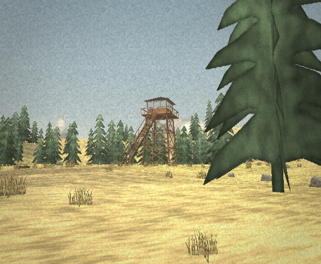
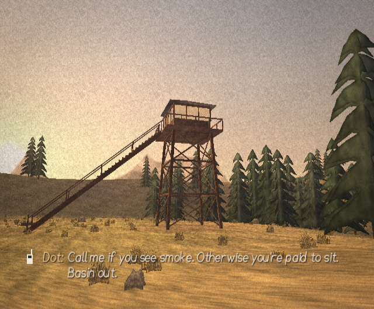
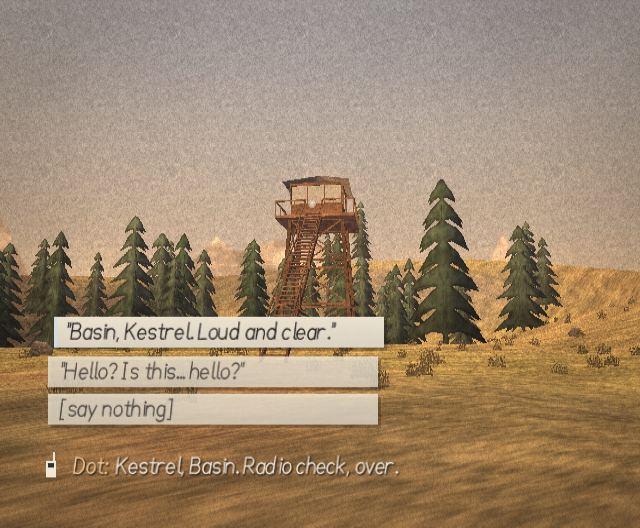
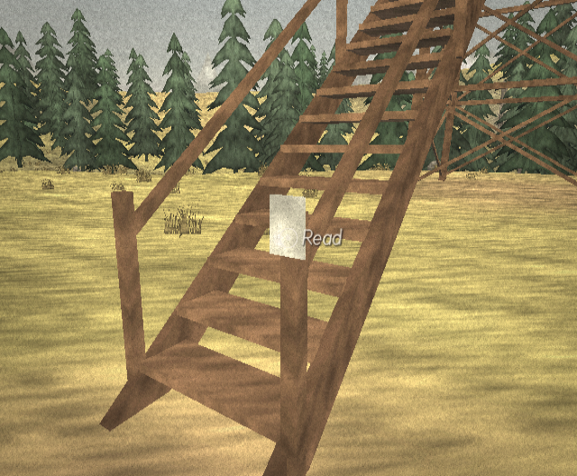
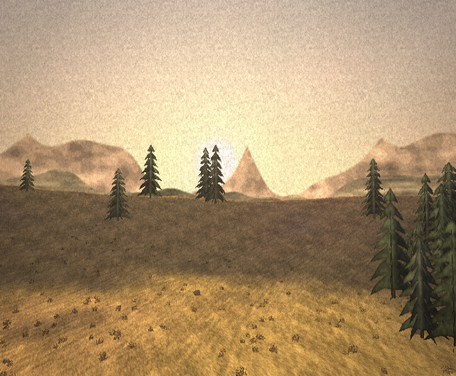
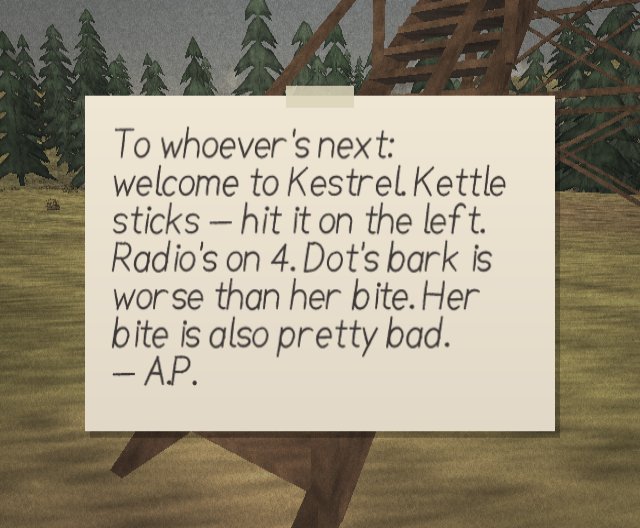
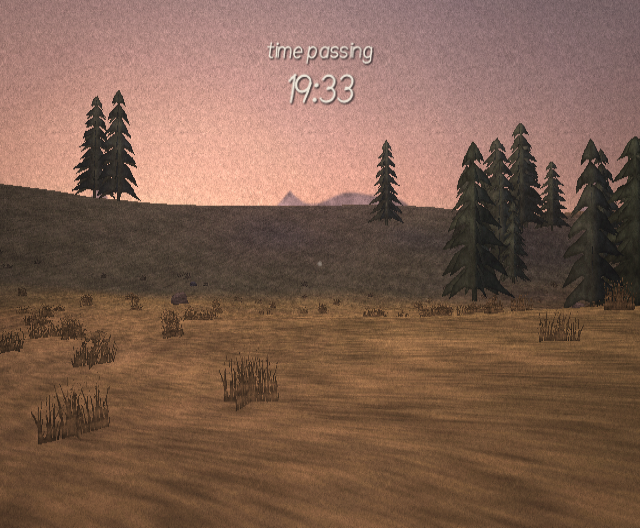
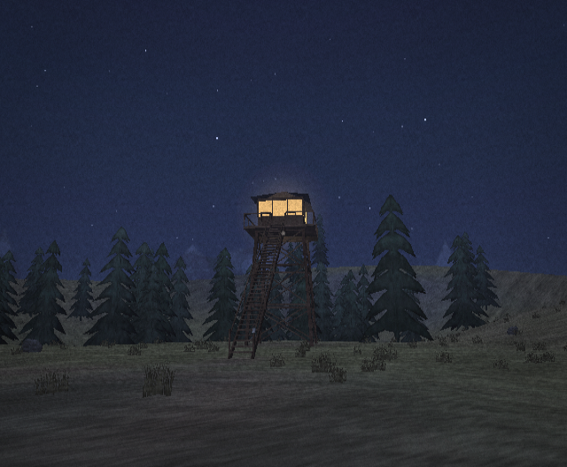

# Phase 2 — Prototype

**Goal (DESIGN.md §13):** walking and looking in a small test area, a simple radio system, one
test location. Build clean, run in Dolphin, then capture screenshots.

All screenshots below are **real Dolphin frame dumps** of `lonelookout_shots.dol` at the Wii's
native 640 × 480: Dolphin 2609, Vulkan backend, copy filter enabled, forced 4:3. They come
from the scripted screenshot tour (`make SHOTS=1`). Reproduce them with
`tools/capture/capture_shots.sh`.

## What was built

| Area | Delivered |
|---|---|
| Build | `make` → `lonelookout.dol` (devkitPPC + libogc). Python generators write every asset into `gen/` first. `make package` builds the Homebrew Channel folder. `make test` runs host-side tests. |
| Renderer | GX setup and frame loop with an adaptive 60 → 30 fps lock. Copy-filter softening. Light-ramp shading via normal texgen. World-planar paper texture. Exp² haze fog. Sky dome recoloured from the colour script, with sun, moon and stars. Three backdrop ridge rings. Cut-paper trees with per-instance wind shear and tint. Grass tufts. Post passes for lift, warm tint, and grain plus vignette. |
| World | A 200 m test bowl around a blockout of Kestrel Lookout: four splayed legs, girts and cross-braces, the deck and railing, the glazed cab (it glows at night), one 36-step stair flight, Augie's note, and a log bench. 160 trees, about 900 tufts, and a trail. |
| Player | Comfort-box pointer look, with turning that eases to a stop when the IR is lost. Analog Nunchuk walking and Z to stride. Snap turn on the D-pad, plus a Remote-only fallback. Head sway and walk bob. Footsteps per surface. Climbable stairs and deck, and collision with legs, trees, railing and the bowl's edge. |
| Interaction | A soft reticle with one-word prompts (*Read*, *Sit*). The note card. Sitting on the log, where holding Z lets time pass ×30 with a clock readout. |
| Radio v0 | The Day 1 radio check, with choice cards and an explicit **[say nothing]**, plus a check-in you start yourself with B. Hand-lettered subtitles with tinted speaker names. Murmur voices. Call chirp, key-up, squelch and carrier hiss. |
| Text | **Lookout Hand**, the original single-stroke font: two variants per glyph, rendered from stroke data in `tools/font/lookout_hand.py`. |
| Audio | A procedural engine on a mixer thread feeding an AESND stream at 32 kHz stereo: gusting wind, birdsong by day, crickets at night, footsteps, UI and radio sounds, and the formant **radio murmur** for both voices. |

## Screenshots

**Test area at noon.** The tower blockout across the bowl. The ground is a two-tone paper wash
from the light ramp, with cut-paper pines (lit and shaded halves) and grass tufts.

**Golden hour, haze and the radio.** The tower in silhouette with its single stair flight. Dot's
last line of the Day 1 call is on screen, with the speaker name tinted.

**A radio call with choices.** "Kestrel, Basin. Radio check, over." Three paper choice cards,
including the explicit *[say nothing]*.

**Interaction prompt.** The soft reticle rests on Augie's note on the bottom stair post, and the
handwritten *Read* prompt appears.

More captures from the tour:

| | |
|---|---|
|  From the deck at golden hour: the far "ash" ranges in haze |  Augie's welcome note |
|  Seated on the log, holding Z: *time passing* |  Night: stars, and the lamp-lit cab glowing across the bowl |

## How it was verified

- **Build:** clean with `-Wall -Wextra` (zero warnings) for `make`, `make SHOTS=1` and
  `make WALKTEST=1`.
- **Dolphin boot:** the real `lonelookout.dol` boots in Dolphin 2609 and renders the opening
  view with the *Day 1* card.
- **Scripted-input run (`make WALKTEST=1`):** synthetic Remote and Nunchuk data drives the *real*
  input → look → walk → radio code in Dolphin.
  - Walking moved the player 12.7 m in 6 s, as expected at 2.2 m/s.
  - The pointer at the right edge turned the view ~64°, and the left edge turned it back.
  - The radio rang about 20 s in. B answered it, D-pad ↓ moved to the second card, and A chose
    it, which played Theo's "Hello? Is this… hello?" branch through to Dot's sign-off.
- **Host tests (`make test`):**
  - terrain heights are sane everywhere
  - walking up the stair flight lands exactly on the deck (10.59 m)
  - the railing holds
  - tower legs push the player out
  - the bowl's edge contains the player
  - murmur line timing is deterministic, and Theo speaks slower than Dot

## Bugs found and fixed along the way

1. **Inverted cull convention.** GX's "front" winding is the opposite of the counter-clockwise
   winding the meshes use, so `GX_CULL_BACK` was removing the outsides of everything. The
   terrain vanished. The tower only *looked* fine because its flat-colour boxes showed their
   inner faces. Solids now cull `GX_CULL_FRONT`.
2. **Paired-single matrix maths.** With GCC 16, libogc's hand-written paired-single
   `guMtx*` routines produced a stale model matrix in one build variant: the terrain was drawn
   at eye height, so the world appeared upside down. It depended purely on code layout. All
   matrix maths now uses libogc's C routines (`c_guMtx*`), which is negligible cost at our
   matrix counts.
3. **DOL wouldn't boot in Dolphin.** `elf2dol` left the data section's size unaligned (0x12A414),
   and Dolphin rounds section sizes up to 32 bytes and rejects a file that ends early. The
   Makefile now zero-pads the DOL to a 32-byte boundary. Without this, Dolphin GUI users would
   also have seen "Could not boot".
4. **Button presses vs. fixed-step simulation.** When a rendered frame ran 2+ simulation steps,
   one press was handled several times: D-pad ↓ wrapped round the choice cards. A frame with 0
   steps could also drop a press. Presses now accumulate until the first step of a frame
   consumes them.

## Known gaps (deliberately left for later phases)

- **Untested on a real Wii.** Everything above ran in Dolphin. Frame timing on hardware is
  unmeasured; the adaptive 30 fps lock exists for exactly this.
- **Audio not heard.** The engine runs in Dolphin without errors, but the headless capture has no
  audio output, so the *sound* of the wind, birds and murmur hasn't been evaluated by ear yet.
- **The check-in call** (B when nothing is ringing) uses the same code path as answering, but the
  scripted run ended before reaching it.
- **Test-area art:** the grain could be gentler at night, the aspen silhouette is a placeholder,
  and there's no cloud layer yet (all Phase 3).
- **The Remote-only scheme has no stride:** B is reserved for the radio. DESIGN.md is updated.

## Next: Phase 3 — World building

Bake the real 512 m Ashen Peaks from `tools/worldgen/ashen_peaks.py` behind the same `world.h`
interface. Then the six areas, the tower and cabin interiors, the remaining interactables,
weather and season, and the notebook.
