# Phase 3 — World building

**Goal (DESIGN.md §13):** worldgen bakers, chunked terrain, foliage with LOD and wind, the tarn,
all six areas dressed, the tower and cabin interiors, the interactables, days, weather and
season, and the notebook. Every area must be reachable on foot.

Every screenshot below is a **real Dolphin frame dump** of `lonelookout_shots.dol`, captured at
the Wii's native 640 × 480 (Dolphin 2609, Vulkan backend, copy filter on, forced 4:3). Run
`tools/capture/capture_shots.sh` to reproduce them.

## What was built

| Area | Delivered |
|---|---|
| World data | `tools/worldgen/bake_world.py` bakes the Phase 1 map (`ashen_peaks.py`) into the `.dol`. It writes 129² heights at 4 m and late-summer and early-autumn vertex colours painted from the worldgen masks: grass, needle duff, meadow, ash, fireweed, scree, cinder, lakebed, sedge, creek margins and trail wear. It also writes a ground-type grid, ~1,860 Poisson-spaced trees and ~6,600 tufts, `world_data.h` (places, trails, the creek, footbridge positions) and the notebook map, lettered in Lookout Hand. |
| Terrain grading | The Phase 1 sketch had 70° trail sections, so the knob and ridge were lowered and widened. The ridge is now asymmetric: long and walkable toward the bowl. Every trail is graded into the hillside, with a smoothed, grade-limited bed profile that the ground is cut or filled to. Junctions agree because each trail is pinned to the bed of the one it starts from. |
| Renderer | 8 × 8 chunked terrain with edge skirts. Seasonal recolouring re-records the lists behind the day card. Trail and creek ribbons are draped on the exact mesh. The tarn has per-frame Fresnel colour and a sun glint. Near trees sway individually; far chunks are one pre-transformed list each. Tufts come in seven kinds: grass, larkspur, ferns, sedge, fireweed, saplings and rocks. A soft cloud layer, rain streaks, lightning, and an interior material lit by the lamp. |
| Kestrel Lookout | Four stair flights wind round the tower, with corner landings, handrails and support posts. Catwalk, the glazed cab (glass invisible from inside), a pyramid roof, the lightning rod and aerial. Inside: the fire finder, cot (with Augie's map under it), stove and kettle, the radio table with handset, logbook and lamp, Augie's shelf, the bird list, the lightning stool on glass feet, and binoculars on the hook. A woodpile and cistern at the base. |
| The other areas | **Pell's Cabin:** board walls, west window, open door, gable roof, porch, spoon chimes, rain barrel. Inside: a table with a drawer and the pressed-flower book, a chair, a bunk and a shelf. **Tarn:** the dock and the tin box. **Ridge:** Augie's carved bench and the cairn. **Meadow:** the half-fallen drift fence and a log. **Burn:** the tagged snag and a fallen snag. **Cold spring:** pipe, trough and cup. **Trailhead:** supply box, sign, the road gate and its fence. Footbridges wherever a trail crosses the creek. |
| Movement | Walk patches for the deck, the flights, the landings, the cabin and the dock. General rules stand in for most railings: never walk off a drop of more than 1 m, never walk into a structure at body height, never enter a slope over 38°. Walls with door gaps, posts, boxes and trunks push the player out. The district line is the rim, the deep tarn and the gate, each with a one-time thought. |
| Interactables | 11 placed notes (N01–N11; N12 arrives in the Day 6 supply box) and 7 sit spots (stool, catwalk, meadow log, dock, ridge bench, fallen snag, porch step). Also the cot (sleep from 19:00), lamp, kettle, logbook, fire finder, radio handset, binoculars, supply box, chimes and gate. The third stair from the top sings a slightly flat E-flat. |
| Days and weather | Seven days with dates and season. Day 1 starts at 15:30 at the trailhead; the radio check rings on first entering the cab (or by 17:00). Sleeping moves to the next morning, recolours the land and shows the day card. Weather: clear, warm, high cloud, a dry storm on Day 4 (14:00–17:30, with lightning and delayed thunder), orange haze on Day 5, crisp air on Day 6, and rain from noon on Day 7. |
| Tools and UI | The **notebook** (D-pad ↓) has Map (with a pencil mark where you stand), Notes, Radio log and Sounds pages. The **binoculars** (D-pad ↑) zoom to 16° with a twin-circle view and pencil labels on places. The **fire finder** gives a sighting ring with the six areas' bearings. Place names appear on arrival, Theo has passing thoughts, and there are small control hints. |
| Audio | New footsteps on needles, ash and scree. The spoon chimes, the singing stair, the kettle whistle, thunder and the lamp switch. A rain bed with drips (brighter on a roof), and wind muffled indoors. |
| Pacing | The story path is now budgeted at **4–6 hours** (DESIGN.md §3). There are **eleven days**: the seven story days plus four quieter ones (*Field Notes*, *Relay*, *Bugle*, *First Frost*). The clock is **2 real minutes per game hour**, so a waking day is about 31 minutes. A daily duty loop fills it: morning and evening readings at the new instrument shelter on the catwalk, and one errand a day. Time-lapse runs at ×40. |

## Screenshots

**Cinder Ridge at golden hour.** Seated on Augie's bench, looking back across the bowl to the
tower on Kestrel Knob, with the far ranges in haze.
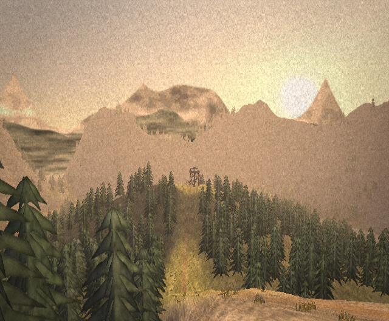

**Inside the cab at night.** The lamp is lit. The cot (with Augie's map under it), the fire
finder, and the lightning stool behind; the glazing is invisible from inside.
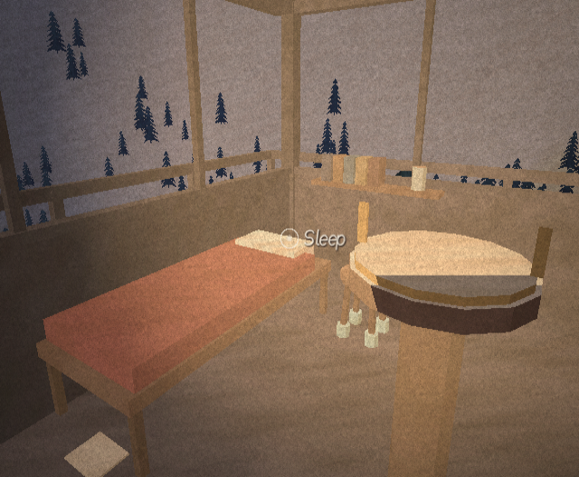

**The '98 Burn in the morning.** The tagged snag by the trail, silver snags, fireweed and
lodgepole saplings growing back.
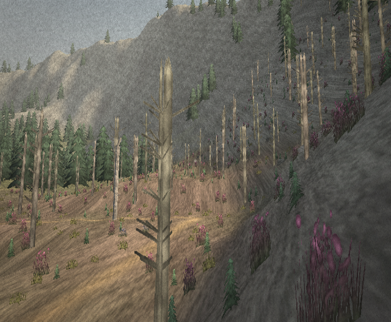

**Mirror Tarn at dawn,** from the end of the dock: Fresnel water with the far shore's pines.
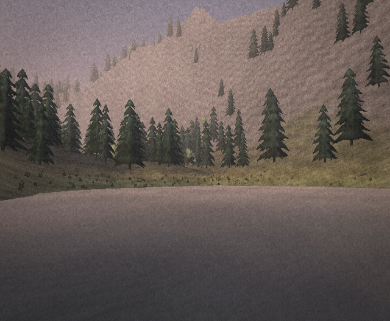

More from the tour:

| | |
|---|---|
| 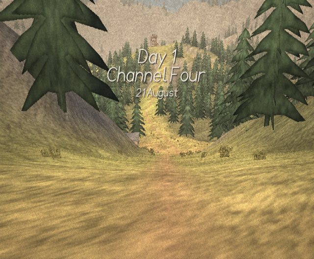 Day 1 begins at the trailhead | 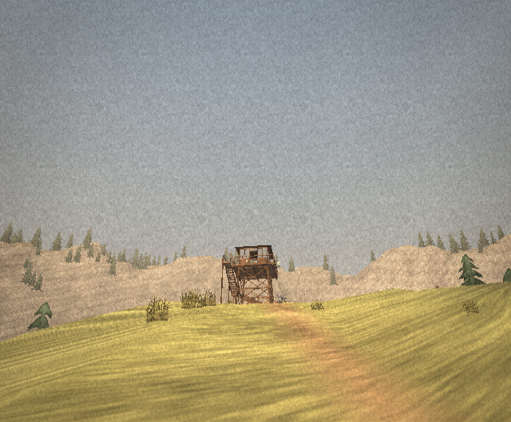 The tower from the trail |
| 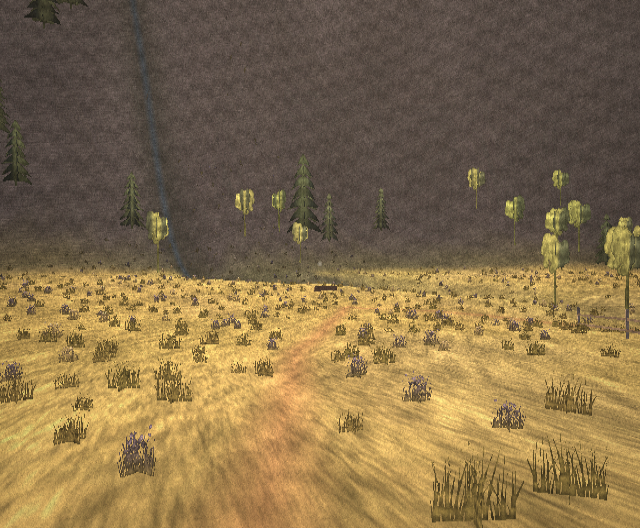 Larkspur Meadow in the afternoon | 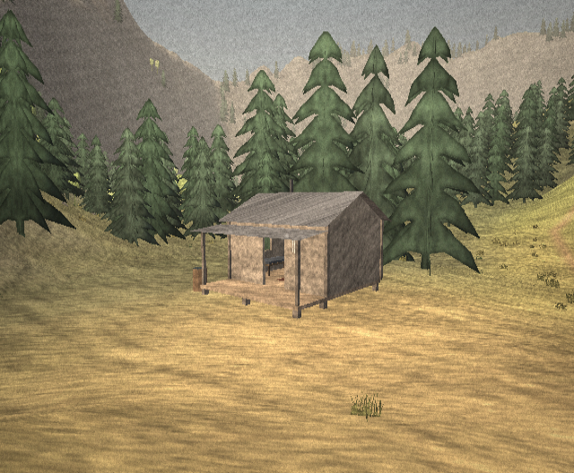 Pell's Cabin |
| 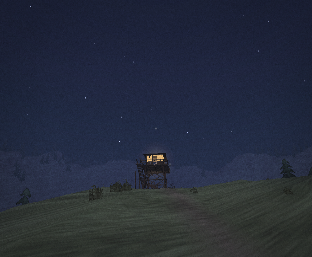 The lit cab from across the knob | 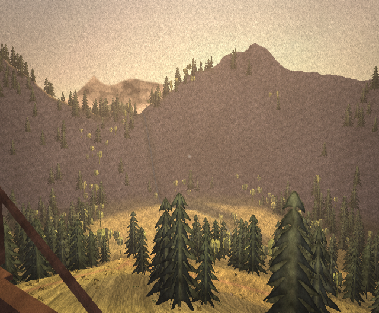 From the catwalk, golden hour |
| 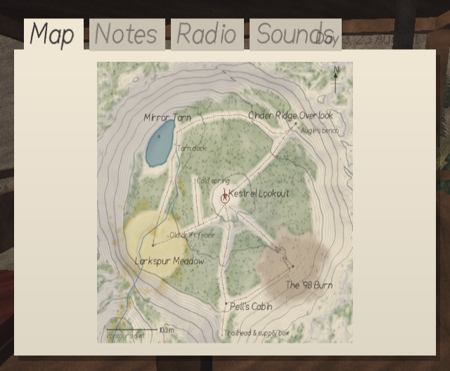 The notebook: Augie's map, with you on it | 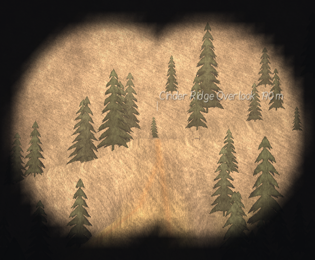 Binoculars on Cinder Ridge |
| 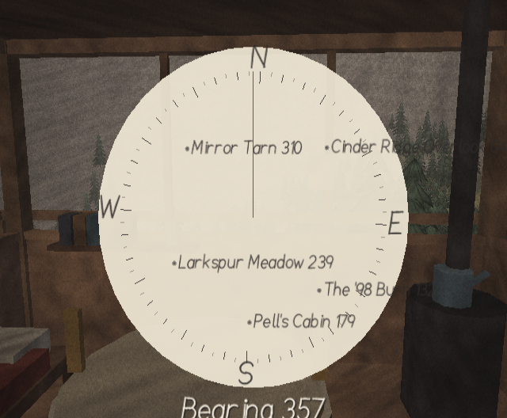 The fire finder's sighting ring | 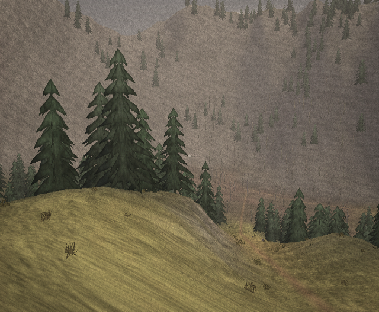 Day 5: dry storm |
| 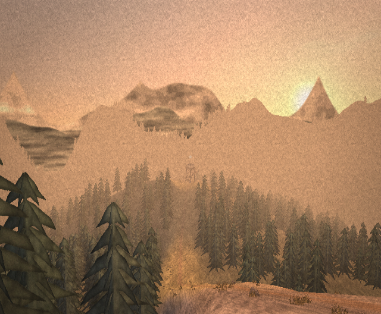 Day 7: orange haze at the bench | 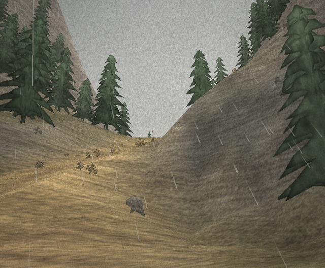 Day 11: rain, from the cabin porch |

## How it was verified

- **Build:** clean with `-Wall -Wextra` (zero warnings) for `make`, `make SHOTS=1` and
  `make WALKTEST=1`.
- **Host tests (`make test`, 5,136 checks):**
  - every trail walked end to end, in 60 Hz steps through the real collision code
  - the tower climbed: flights A–D, the top landing, the deck, through the door into the cab
  - the cab walls, the fire finder and the deck railings hold
  - the cabin entered by its door, and its walls hold
  - the dock walked to its end; the deep tarn and the road gate stop the player
  - four walks out toward the rim all stopped well inside the map
  - every sit spot's eye sits sensibly above its seat
  - no tree stands on a trail
  - the singing stair is found at the right tread
- **Terrain analysis:** the steepest point on any trail is 35.5° (the ridge scramble); most are
  20–25°. A flood fill from the trailhead reaches every area and only touches the map's edge on
  the road, behind the gate.
- **Dolphin:** the tour above runs every system on the real map: the day card, seasons across
  Days 1–11, storm, haze and rain, the interiors, the notebook, the binoculars and the fire finder.

## Problems found and fixed along the way

1. **The Phase 1 map couldn't be walked.** Its knob and ridge gave trail sections of 60–70°. The
   relief was lowered and widened, the ridge was made asymmetric, the rim was eased behind it,
   and every trail was graded with a smoothed, grade-limited bed. Blending between trails uses
   the nearest point on *each* trail, weighted, so junctions and bends stay continuous.
2. **Display lists ahead of their data.** The Makefile's "embed data before compiling" rule
   named `CFILES`, which the inner make never sees. It only worked because of build order. The
   rule now uses the exported object lists.
3. **Button presses seen twice in one step.** B closing a note also raised the radio, as it did
   in Phase 2. Handlers now *take* a press (`in_take`), so later ones don't see it.
4. **Bare rim walls.** The bowl's steep inner faces read as flat paper walls behind the meadow
   and the tarn. Sparse stands of unreachable trees now break them up (about 430 more trees).
5. **Composition.** The tarn shot first faced straight into the west rim, so the dock seat now
   looks south down the lake.

## Known gaps (left for Phases 4 and 5)

- **The story's words.** Days 2–11 have their weather, season, supply boxes, logbook lines and
  readings, but the radio still carries only the Day 1 check and the check-in. The daily calls,
  errands, the Relay crew, the elk count and the sound log are Phase 4.
- **The 4–6 hour budget is a plan, not a measurement.** It is checked against the clock and the
  walking times; a timed playthrough in Dolphin is a Phase 4 exit criterion.
- **Untested on a real Wii.** Frame times on hardware are unmeasured. The new costs are
  ~1,860 trees (far chunks batched), the ribbons and the water grid; the 30 fps lock is the
  safety net.
- **Art:** the rim's scree is still plain up close, the tarn doesn't reflect, and the binocular
  labels can crowd.
- **Saves:** none yet (Phase 5).
