# Phase 4 — Narrative & audio

**Goal (DESIGN.md §13):** the dialogue compiler and all eleven days of calls; the duty loop
(readings, errands, morning and evening reports); flags and retries; notes and the logbook; the
sound log; the synth (ambience, birds, weather, footsteps, the tower); the music sequencer and six
pieces; the murmur voices and an SD-card voice-over loader; mixing and ducking.

**Exit criteria:** a story playthrough and an ignore-everything playthrough both reach the ending;
a timed story playthrough lands in 4–6 h; no audio underruns in a 1 h soak.

Every screenshot below is a **real Dolphin frame dump** of `lonelookout_shots.dol` at the Wii's
native 640 × 480 (Dolphin 2609, Vulkan, copy filter on, forced 4:3). Run
`tools/capture/capture_shots.sh` to reproduce them.

## What was built

| Area | Delivered |
|---|---|
| The radio script | `data/dialogue/*.lls`: a small plain-text format, one file per day plus `checkins.lls` and `defs.lls`. A call has a header (`day`, `time`, `retry`, `where … until`, `needs`, `after`, `kind`, `garble`), then lines (`DOT`, `THEO`, `CREW`), `choice` / `>` options with conditions and flags, `node` / `goto` / `branch`, `set` / `clear`, `do` actions and `{tokens}` for live readings. `tools/dialogue/compile_lls.py` checks it (unknown nodes, flags, calls, characters the font can't draw) and compiles it into C tables. **70 calls** (52 story, reports and small talk across eleven days, plus 18 check-ins), **525 lines, 53 choices, ~5,000 words.** |
| The runtime | `src/game/dialogue.c` is pure logic, so the host tests run the same code as the Wii. Calls ring on their own when their day, time window, place (anywhere, an area, the cab, the cabin, a seat), flags and prerequisite calls allow. Story calls come before reports, and reports before small talk. An unanswered call tries again 45 game minutes later, until its retry time, then counts as missed; nothing ever blocks the season. Pressing **B** with nothing ringing plays something Theo has to report (the smoke, the elk count), otherwise the least-recently-used check-in for the time and place. |
| The radio UI | The chirp, the handset, subtitles timed to the murmur, choice cards (pointer or D-pad), the Radio log in the notebook, the Harrow crew's wind-garbled relay on Day 6, and the open carrier after Dot falls asleep. |
| Duties and errands | Readings at the instrument shelter (morning and evening) feed Dot's report calls: *"Dry {dry}, wet {wet}…"* is only offered once you've read them. Each day's errand comes from Dot's morning call: the spring, the supply truck, Augie's round (the **rain gauge** in the meadow, the spring, a **stone for the cairn**), fire watch, the relay from the ridge, the bench at seven, the bulls at dusk, the postcard, the closing chores (**shutters** on Pell's Cabin, the tower **cistern** valve). The notebook's new **Today** page shows the forecast, the two readings and the errand, ticked off in red pencil. |
| Story events | **Day 5:** a white smoke column rises at 16:30 out on Harrow Ridge at bearing 104. Theo notices it when it's in view; **A** in the fire finder takes a bearing, and a call to Basin reports it. Miss it, and Prospect Lookout reports it instead. **Days 2–9:** a doe and twin fawns graze below the drift fence in the mornings and bolt if you come within 22 m. **Day 8:** sit on the meadow log at dusk and four bulls bugle from around the bowl, panned where they are; count them for Dot. **Day 11:** the rain arrives, the last call comes at 19:30, and the gate opens onto a closing card (which changes with what you told Dot) and the credits. |
| The sound log | **Listen** (hold **C**, or **−** without a Nunchuk): the world quietens and Theo slows. Sounds he can hear get handwritten labels where they are, or at the edge they're off to. Stay on one for three seconds (an underline fills) and it's written into the notebook with a pencil scratch. Twelve sounds at their places and hours: the third stair (E-flat, not F), the creek, grasshoppers at midday, an elk, the sandpiper at dawn, chorus frogs at night, a pika in the scree, wind in the burn's snags, the woodpecker, the spoon chimes, rain on the cab roof, and *almost nothing* (ten seconds on the ridge on a still night). The first one logged prompts Dot's *"What does it sound like up there?"* |
| Ambience | `src/audio/ambient.c` synthesises the sound log's beds from noise, filters and a few oscillators (creek bubbles, grasshopper click trains, the sandpiper's *peet-weet*, frogs' pulsed "comb" calls, the pika's squared-off *eep*, a hollow snag whistle with creaks, decelerating woodpecker rolls, spoon chimes in the wind, metallic rain pings). Gain falls off with distance and is muffled indoors; pan follows where each is relative to Theo's facing. The wind, rain, birds and crickets from Phase 3 carry on underneath. |
| Music | Six pieces written as note data (`data/music/*.txt`, 1:04–1:17 each): *Channel Four*, *Settling In*, *Mirror Tarn*, *Ash & Fireweed*, *Seven O'Clock*, *First Rain*. All are built on the Kestrel motif D–A–B–F♯–E, which hangs on the E until the credits' coda finally resolves it to D. `tools/music/compile_music.py` compiles them. The sequencer (`src/audio/music.c`) may drop the bars a score marks optional, swap the ones marked swappable, breathe the tempo by ±3 % and nudge every note's timing and touch, so no two plays match. Instruments: a Karplus-Strong DADGAD guitar with a two-resonator body, guitar harmonics, an additive felt piano (six stretched partials on rotating phasors, a hammer thump, a damper), a low drone and a quiet pad, through a small Schroeder reverb. |
| When music plays | `src/game/director.c`: on the first arrival at an area each day, at sunrise and golden hour outdoors, after sitting 20 s, and on story beats (the trail on Day 1, after the smoke night, *Seven O'Clock* at the bench, *First Rain* at the last call, the coda under the credits). Automatic cues wait for four minutes of silence, so music fills roughly a quarter of the time. |
| Mix | Ambience ducks −5 dB under the radio and −6 dB in Listen, where the focused sound comes **up** +4 dB. Music ducks −9 dB under the radio and −12 dB in Listen. While listening, the left channel is gently low-passed: Theo's bad ear. |
| Voices | The murmur from Phase 2, now with the crew's voice and garbling. **Voice-over loader** (`src/audio/vo.c`): if `SD:/apps/lonelookout/vo/` exists, each line looks for `<LINE_ID>.pcm` (raw 16-bit LE mono, 22,050 Hz) on a background thread and plays it through the same handset chain, falling back to the murmur. `gen/vo_lines.txt` lists all 525 IDs with speaker and text for a cast. |

## Screenshots

**Day 7, seven o'clock.** On Augie's bench, in the orange haze from fires to the south, Dot asks
Theo to describe the sunset she has heard seven thousand times and never seen.
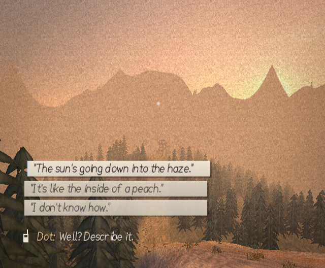

**Day 5, 17:20.** A thin column of smoke rises out past the burn after the dry lightning, seen
from the catwalk. Theo takes its bearing in the fire finder (104) and calls it in.
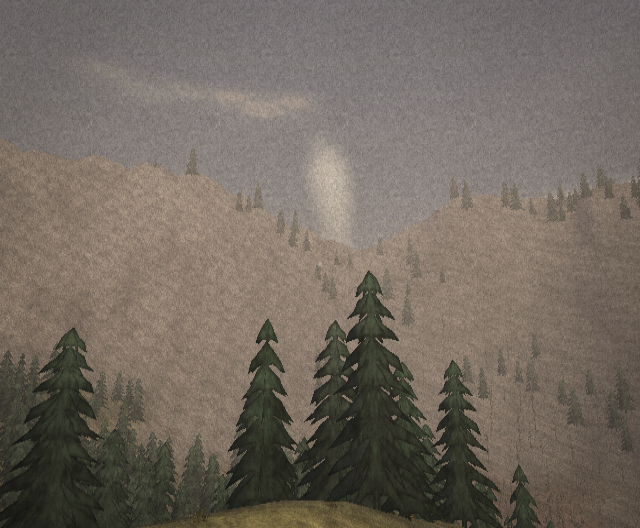

**The notebook.** *Today* keeps the duties: the forecast, the two readings and the day's errand,
ticked in red pencil. *Radio* is everything said on the radio. *Sounds* is the sound log, with
what Theo wrote about the sound picked out.

| | |
|---|---|
| 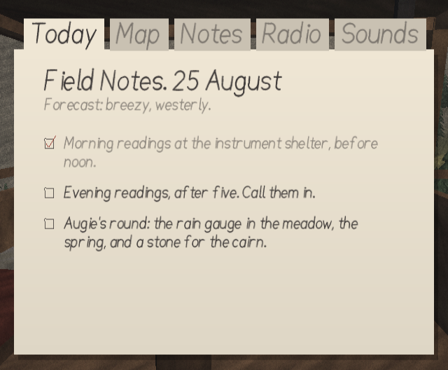 Day 4: Augie's round | 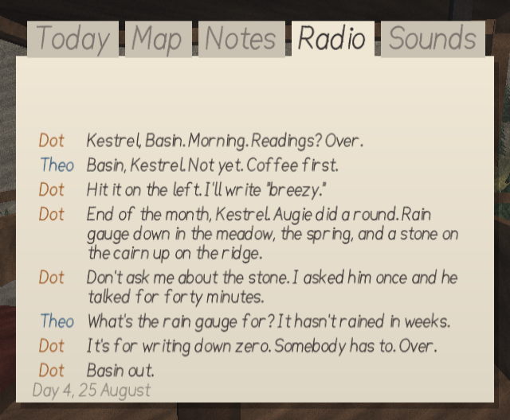 The morning call, in the log |
| 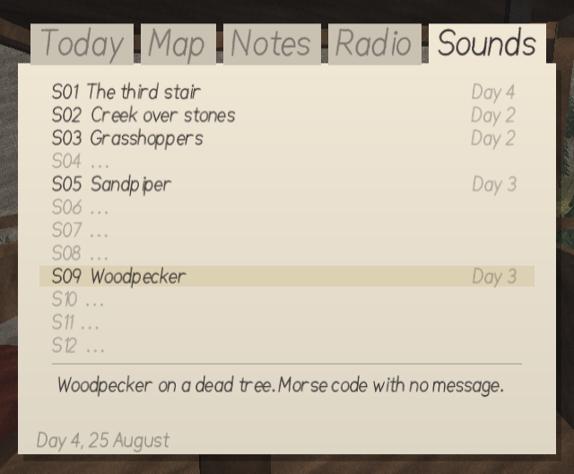 Five sounds written down | 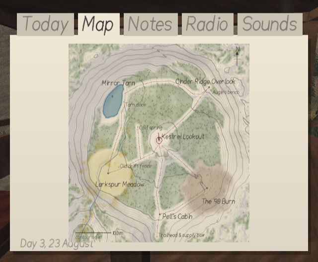 Augie's map |

**Listen.** Holding C: the edges darken, the world quietens and the sounds Theo can hear get
labels. The focused one (underlined) fills in as he stays on it.

| | |
|---|---|
| 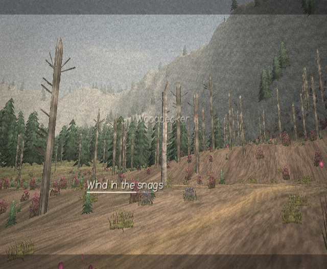 The burn: wind in the snags, a woodpecker | 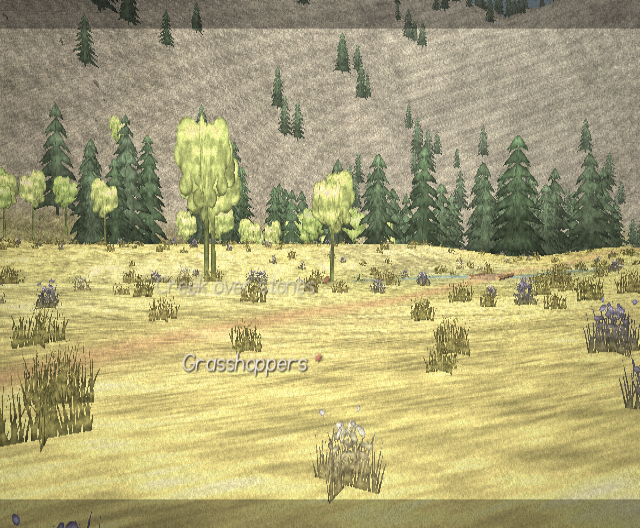 The meadow at midday: grasshoppers, the creek |

**Day 11.** The first rain in seven weeks, from the cabin porch and from the catwalk; and the
closing card through the gate (its lines depend on what Theo told Dot).

| | |
|---|---|
| 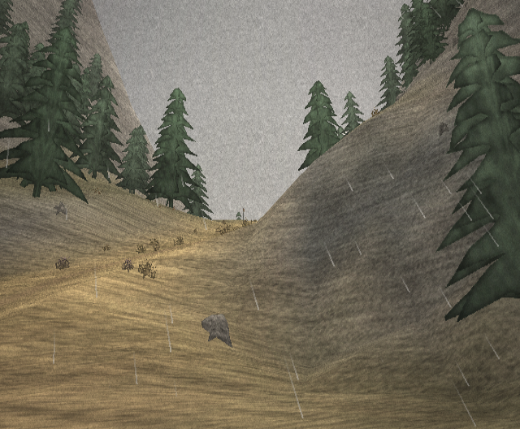 Rain from the porch | 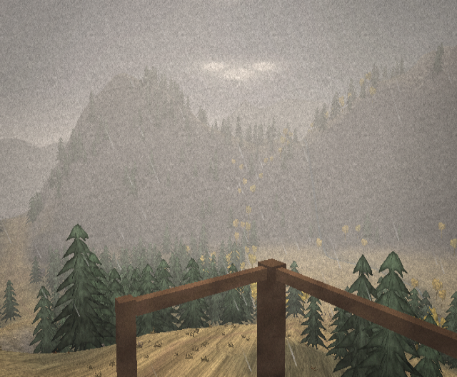 Rain from the catwalk |
| 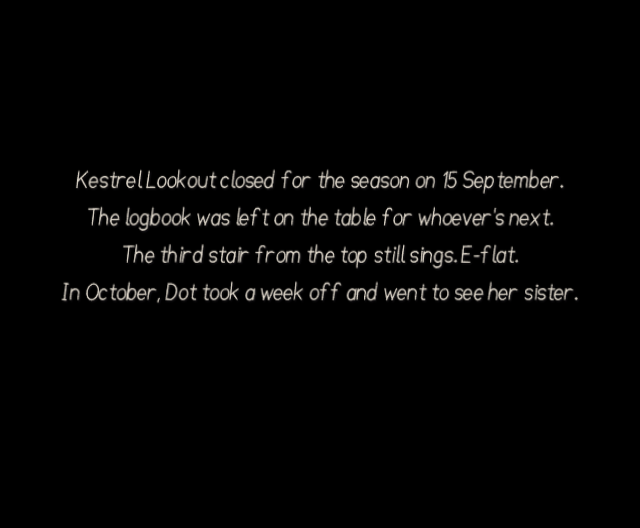 Through the gate | 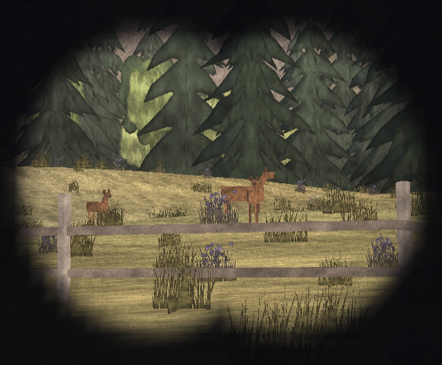 Day 2: the doe and twins, through the binoculars |
| 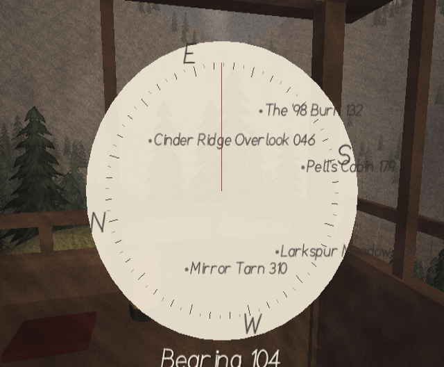 The fire finder on the smoke's bearing | 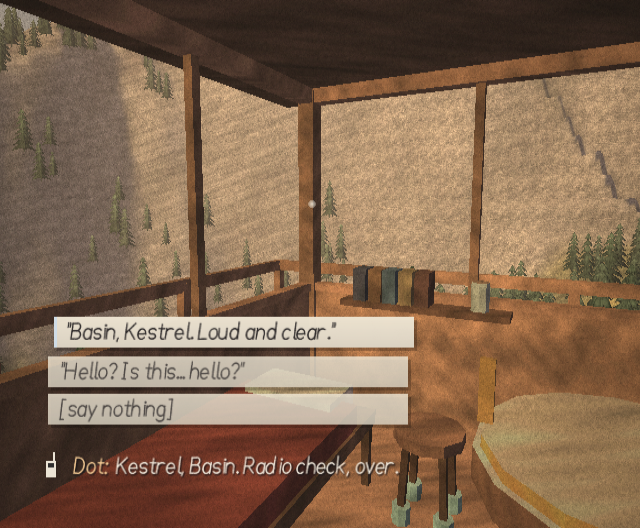 Day 1: the radio check |

## How it was verified

- **Builds:** `make`, `make SHOTS=1`, `make WALKTEST=1` and `make SOAK=1` are clean with
  `-Wall -Wextra` (zero warnings).
- **`make test`** now runs three host programs against the same C the Wii runs:
  - *World* (`test_world.c`, 5,140 checks): unchanged from Phase 3, plus the new props.
  - *Story* (`test_story.c`, 4,026 checks):
    - **Script structure.** Every op of all 70 calls is reachable, every path ends, every jump
      stays in its call, every option fits a card, every `{token}` is known, and the fallback
      check-in is always available.
    - **The story path reaches the ending in 4.64 h.** A player who does each day's duties and
      errand, wanders and sits in real time and time-lapses one evening wait a day. All 49 story
      calls play, including the smoke report, the relay, the bench at seven, the bull count and the
      last call. Day 1 takes 12 min; days 2–10 about 27 min each; Day 11 24 min.
    - **Ignoring everything reaches the ending.** Never answering, never reading, time-lapsing
      every day on the stool and sleeping at seven: no call plays, and the gate still opens on the
      last evening (about 35 min).
    - **Sixty randomised seasons all reach the ending** (4.7–5.1 h). They use random answer delays
      (some slower than the ring), one in seven who never answer, random choices and a quarter of
      every day's steps skipped. No line ever goes out with a raw `{token}`.
    - **Voice-over IDs:** every line spoken in those runs (13,187) has its ID in `gen/vo_lines.txt`.
  - *Audio* (`test_audio.c`, 68 checks):
    - Every instrument is in tune to within 10 cents (autocorrelation pitch of a held note).
    - Each piece renders start to finish with no NaNs, no clipping (peaks 0.26–0.75), sensible
      loudness (RMS 0.05–0.09) and the right length. The rendered files have no sample-to-sample
      jumps (clicks).
    - The ten beds render cleanly. Cost: music about 2.5 ms per second of audio on the host, a few
      percent of a Wii core at a conservative 20× ratio. Two denormal stalls (decaying reverb and
      filter tails) were found and fixed this way.
- **Dolphin:**
  - The screenshot tour drives the real game code for every shot below.
  - **Audio soak:** see below.
