# Phase 5 — Polish & testing

**Goal (DESIGN.md §13):** a performance pass (overdraw, culling, TEV trimming); options and
saves; the title, day cards, ending and credits; the Dolphin test matrix; Homebrew Channel
packaging; build and run documentation.

**Exit criteria:** the test matrix all green; a release `.dol` and package; a README with build
and run instructions.

Every screenshot here is a **real Dolphin frame dump** at the Wii's native resolution (Dolphin
2609, Vulkan, copy filter on). `tools/capture/capture_shots.sh` reproduces the tour shots and
`tools/test/matrix.sh` the test runs.

## What was built

| Area | Delivered |
|---|---|
| Saves | `sd:/apps/lonelookout/save.dat`: a big-endian file with a magic number, a version, the body length and a **CRC32**. The body holds the options, then (if a season is under way) the day, the clock, position and view, notes found, supplies, sounds logged and when, the thoughts already said, the day's flags (binoculars, readings, the kettle, the lamp), the areas visited today, the notebook's pages, the errand and story state, the radio log, and the radio script's flags and calls. The script's state is saved **by name**, so editing the script later doesn't scramble old saves: unknown names are skipped. A file that fails any check is ignored. It is written to `save.tmp` and renamed over the old one, so a power cut mid-write leaves the previous save. Saved on going to sleep, on **Save and quit**, and on **Save and return to the title**; options are saved when you leave the Options screen. |
| The title | Augie's bench on Cinder Ridge at golden hour, looking back at the tower, with *Channel Four* playing; the light drifts slowly round the sunset. **Continue** shows the saved day and time; **New season** asks before replacing a save; **Options**; **Homebrew Channel** (back to it). Without an SD card a note says the season won't be saved. |
| Pause | **HOME** or **+** in play: time stops. Resume, Options, *Save and return to the title*, *Save and quit*. |
| Options | Look sensitivity (0.5–2.0), comfort-box size (S/M/L), invert look, snap turn, head sway, walk bob, compass, larger subtitles, a backing behind subtitles, the hearing effect, mono, three volumes (sounds of the world, the radio, music, 0–10) and a 30 fps lock. Each takes effect as you change it. |
| The compass | An option: the heading pencilled at the top of the screen (*NE 047*). |
| Remote only | With no Nunchuk, a hint gives the Remote-only controls once, and again whenever the Nunchuk comes out. |
| Credits | Mention the voices on your SD card when there are any. |
| Font | Every glyph now starts at the pen, so the gap between letters is always the same, and the word space is wider. Spaces after *1*, *.* and similar no longer vanish (*Kestrel Lookout*, not *KestrelLookout*). |
| Packaging | `make package` writes `dist/apps/lonelookout/{boot.dol, meta.xml, icon.png}` and `dist/lonelookout-1.0.zip`. The icon is drawn by `tools/assets/make_icon.py`, with the title fitted beside the tower. |
| Test builds | `make PERF=1` (the worst views, with the triangle counts on screen), `make REMOTETEST=1` (the walk test without a Nunchuk), `make MENUTEST=1` (title, pause, Options, save, Continue, Save and quit, all scripted), `make SOAKRIDGE=1` (the time-lapse soak on the bench). `tools/test/dolphin_run.sh` runs a build in headless Dolphin with given settings and keeps every Nth frame; `tools/test/matrix.sh` runs the matrix. |

## Screenshots

**The release captures** (`lonelookout_shots.dol`, no overlay):

| | |
|---|---|
|  | 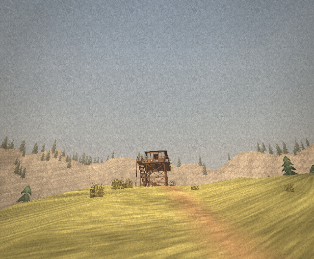 |
| **The title:** Augie's bench at golden hour, the tower to the right of the menu. | **The tower** from the trail, Day 1. |
| 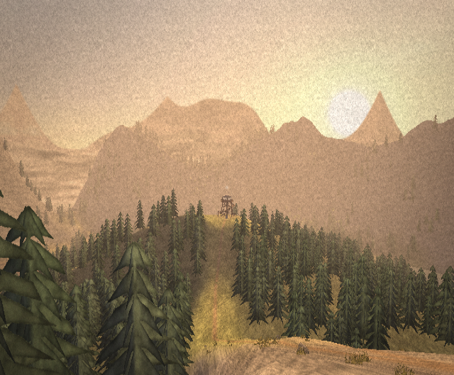 | 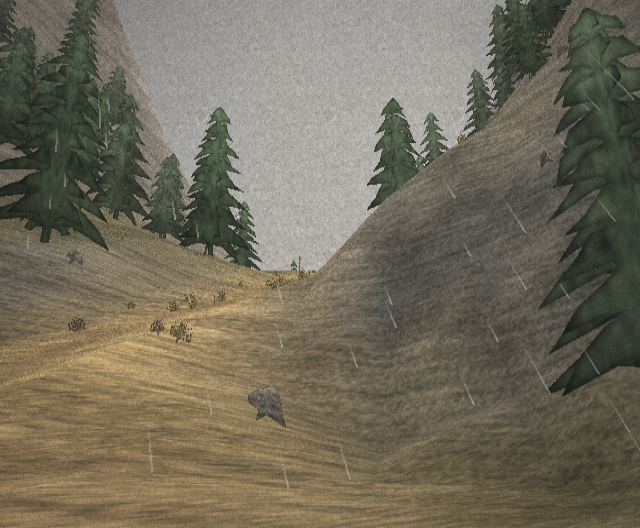 |
| **Cinder Ridge at golden hour:** the heaviest view for the triangle budget. | **Rain** on the last day, from the porch seat at Pell's Cabin. |

**From the test runs** (scripted builds, so the developer overlay is on):

| | |
|---|---|
| 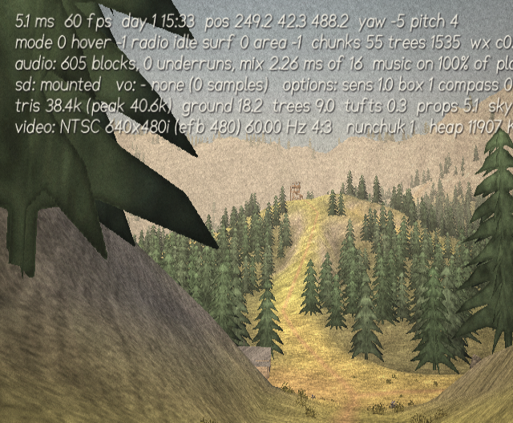 | 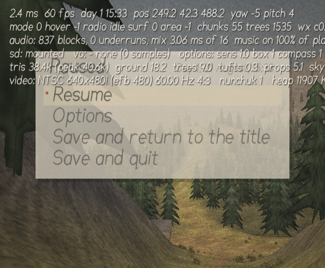 |
| **Options**, mid-run in `MENUTEST`, with the compass just turned on. | **The title after saving:** *Continue — Day 1, 15:33*. |
| 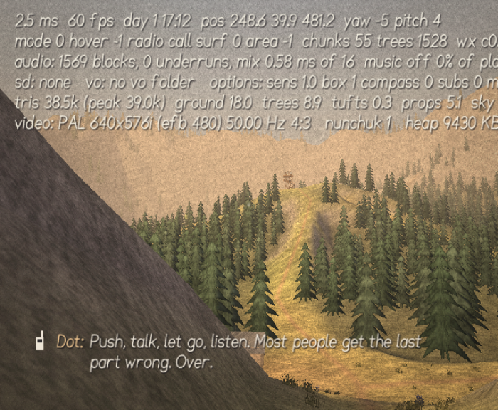 | 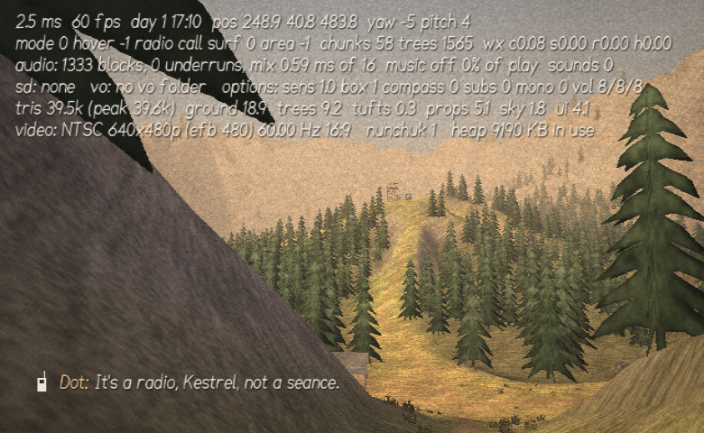 |
| **PAL 50 Hz**: *PAL 640×576i, 50 Hz* on the overlay's last line. | **16:9**: the wider view, the UI on an 854-wide canvas. |
| 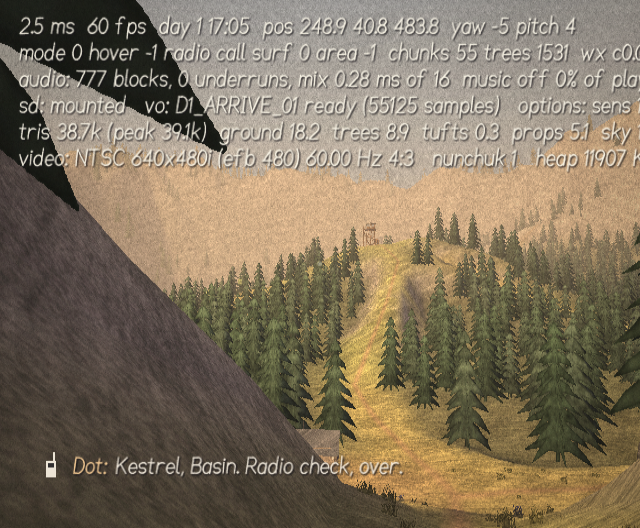 | 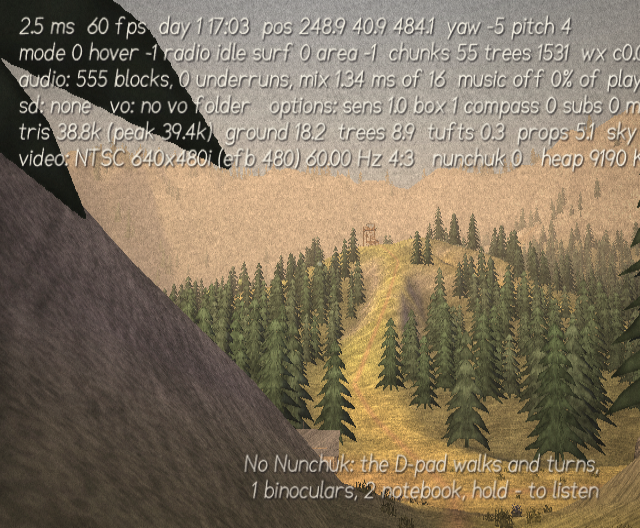 |
| **A recorded line from the SD card:** *vo: D1_ARRIVE_01 ready (55125 samples)*. | **No Nunchuk:** the D-pad walked here, and the two-line hint gives the Remote-only controls. |
| 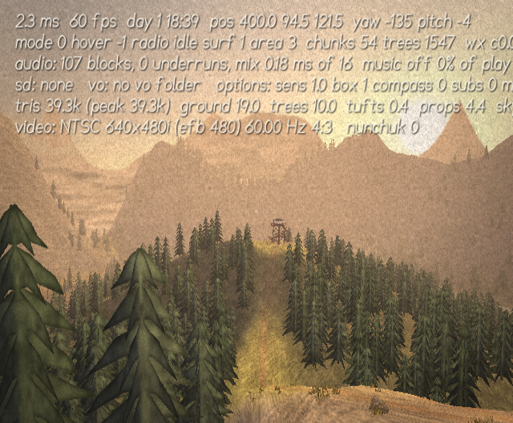 | 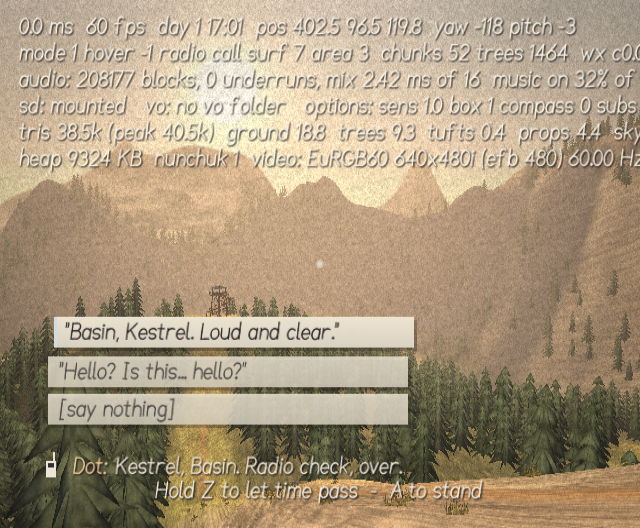 |
| **The worst view** in `PERF`: 39.3k triangles, ground 19.0k, trees 10.0k. | **The end of the ridge soak:** a third season's Day 1, 208,177 blocks, 0 underruns, heap 9,324 KB. |

## The performance pass

Dolphin doesn't model the GPU's time, so the frame budget is checked by **counting triangles**:
every display list's triangles are counted once when it's recorded (by walking its draw
commands), and immediate draws go through a counting `gx_begin`. The developer overlay shows the
last frame's total, the peak, and the split by the budget's lines (DESIGN.md §11).

The first count, at the trailhead on Day 1, was **68k triangles**, against a budget of 44k:
terrain 35k (budget 18k), trees 18k (12k), tufts 15k (6k), props 7k (5k). What changed:

- **Terrain.** Chunks more than 96 m away draw a **half-resolution** list: about 40 % of the
  triangles. Its interior is coarse strips. Its border cells are fans that keep every
  full-resolution vertex along the chunk's edges, so it meets a full-resolution neighbour, or
  another coarse one, with no cracks and no skirts.
- **Trails** were one list per trail, drawn whole if any of it was in view. They're now cut
  where they cross from one terrain chunk to the next and culled piece by piece. A piece in a
  coarse chunk uses every other sample and is lifted clear of the coarse ground there.
- **Trees.** Beyond 150 m, a chunk's trees are two whole planes at right angles (4 triangles
  instead of 12). Their left and right edges have the near trees' normals, so the light ramp
  still splits them into a lit and a shaded half.
- **Tufts** live in 16 m cells and are drawn within 44 m. They were in 64 m chunks drawn to
  62 m, which could cover a 190 m square.
- **Props.** Each group has a draw range: the tower's and the cabin's interiors only up close,
  the smaller sites out to 120–200 m. The tower, the cabin and the bridges always draw.
- **TEV.** The far trees and the tufts have their tints baked into their vertex colours, so they
  use two TEV stages instead of three. Alpha-tested foliage is where overdraw is worst, and
  each stage costs fill rate. The interiors fold from four stages to three: albedo × (2 ramp ×
  dim × 2 tooth + lamp), with the first two stages unclamped so the result matches the old
  four-stage version.

Results from `make PERF=1` in Dolphin (thousands of triangles; *ground* is terrain plus trail
ribbons):

| View | Total | Ground | Trees | Tufts | Props |
|---|---:|---:|---:|---:|---:|
| **Budget (DESIGN §11)** | **44** | 18 | 12 | 6 | 5 |
| Trailhead, Day 1, before the pass | 68.1 | 35.0 | 18.4 | 15.0 | 7.2 |
| Ridge at golden hour, looking SW (the named worst view) | 39.3 | 19.0 | 10.0 | 0.4 | 4.4 |
| Ridge, looking W | 32.5 | 16.0 | 7.1 | 0.3 | 3.7 |
| Ridge, looking S | 26.6 | 13.0 | 7.7 | 0.4 | 0.8 |
| Augie's bench, toward the tower (the title view) | **39.6** | 19.5 | 9.9 | 0.4 | 4.4 |
| Trailhead, looking N | 38.6 | 18.4 | 9.4 | 0.3 | 5.1 |
| Tower deck, SW | 26.3 | 11.1 | 5.2 | 0.4 | 4.9 |
| Tower deck, N | 25.2 | 9.6 | 5.1 | 0.4 | 4.6 |
| Meadow, looking E (densest tufts) | 32.3 | 15.2 | 7.1 | 1.6 | 3.9 |
| Meadow, looking W | 15.6 | 6.0 | 2.9 | 1.7 | 0.5 |
| The burn, NW | 37.6 | 18.0 | 8.3 | 1.7 | 4.2 |
| Pell's Cabin, looking N | 38.0 | 18.9 | 8.6 | 0.5 | 4.7 |
| Mirror Tarn, seated | 21.1 | 10.8 | 3.5 | 0.4 | 0.9 |
| Rain, Day 11 | 12.3 | 4.4 | 1.3 | 0.3 | 1.6 |
| The smoke, Day 5 | 25.8 | 9.9 | 5.9 | 0.3 | 4.7 |

The rest of each total is the sky (1.2–1.8k: dome, backdrop ranges, clouds, water, rain) and the
developer overlay's own text (about 4k, drawn with four shadow passes per letter). Neither the
game's HUD nor its menus come near the 300-triangle UI line.

The **peak is 39.6k**, inside the 44k total. *Ground* sits at the terrain line's 18k at the
heaviest views because it also carries the trail ribbons (2–4k), which the Phase 1 budget didn't
list. The frame-time column of the overlay (Dolphin's CPU estimate) stays at 1.4–5.1 ms of the
16.7 ms frame, so the game never drops to its 30 fps lock on its own in Dolphin.

## The Dolphin test matrix

`tools/test/matrix.sh` runs each row in headless Dolphin and keeps a frame every two seconds.
The developer overlay in those frames shows what to check: the video mode, the aspect, the
Nunchuk, the SD card and voice files, the mixer's underruns and the triangles. The walk-test
rows each run 26 s of scripted play: walking up the trail, turning, then Dot's 17:00 call,
answered, with the second card chosen.

| Row | Build and Dolphin settings | Result |
|---|---|---|
| NTSC 480p, 4:3 | `WALKTEST`, region NTSC-U, progressive scan on | ✅ *NTSC 640×480p, 60 Hz, 4:3*. The call rings at 17:00 and the second card's branch plays (*"It's a radio, Kestrel, not a seance."*). 0 underruns, 38.5k triangles. |
| NTSC 480i | progressive scan off | ✅ *NTSC 640×480i*, the same run. |
| PAL 50 Hz | region PAL, PAL60 off | ✅ *PAL 640×576i, 50 Hz*: the 480-line EFB scales to 576 and the simulation keeps its fixed 60 Hz step. (The overlay's frame rate read "60 fps" here; it now shows the real rate.) |
| PAL 60 | region PAL, PAL60 on | ✅ *EuRGB60 640×480i, 60 Hz*. |
| 16:9 | widescreen on | ✅ Anamorphic projection with a wider view (58 terrain chunks and 1,565 trees in view against 55 and 1,531), and the UI laid out on an 854-wide canvas, so text isn't stretched. |
| No Nunchuk | `REMOTETEST` | ✅ *nunchuk 0*: the D-pad walks the same 13 m, and the call is answered and played through. The Remote-only hint ran off the left edge in the first run; it's now two lines, and a rerun shows it whole. |
| SD card with a voice file | `WALKTEST`, virtual SD with `vo/D1_ARRIVE_01.pcm` | ✅ *sd: mounted*, *vo: D1_ARRIVE_01 ready (55125 samples)*: the recorded line plays in place of the murmur, and the next lines, with no files, fall back to it. |
| No SD card | `WALKTEST`, SD card removed | ✅ *sd: none*, *vo: no vo folder*; murmur voices, 0 underruns. |
| Menus and saves | `MENUTEST`, virtual SD, starting empty | ✅ The title offers New season (no Continue without a save). Then: play, pause, Options (compass on), Save and return to the title (now *Continue: Day 1, 15:33*), Continue (the day card, the compass still on), pause, Save and quit. Dolphin exits cleanly (code 0) and `save.dat` is 100 bytes: magic, version 1, an 86-byte body, CRC32 correct. |
| The worst views | `PERF` | ✅ Peak 39.6k triangles (the table above). |
| A full story run and an ignore-everything run | `make test` (the real dialogue runtime and clock) | ✅ The story path reaches the ending in 4.64 h with all 49 story calls; ignoring everything still reaches the ending; 60 randomised seasons all end, in 4.7–5.1 h. |
| One hour of time-lapse on the ridge | `SOAKRIDGE`, `SOAK_VARIANT=ridge tools/capture/soak.sh` | ✅ **62 minutes, 0 underruns, no leak.** Seated on Augie's bench holding Z (time at 40×). Each day ends at 21:30 and the next begins (Day 11 wraps to a fresh season), so the hour ran through **about three seasons, some 33 days**. That covers every palette and weather, a seasonal re-recording of the terrain and foliage lists at every day change, and the calls, answered and played through. 208,177 mixed blocks; mixing took 0.7–4.1 ms of each 16 ms block; music on 30–39 % of the time. **Heap in use: 9,323 KB at the start, 9,324 KB at the end.** Final frame: [`test_ridge_soak.png`](../screenshots/phase5/test_ridge_soak.png). |

The save format has its own host tests (`tests/host/test_save.c`, 24 checks): the byte writer
and reader round-trip and are big-endian; reads past the end are caught; long strings are cut,
not overrun; the CRC matches the standard check value and catches every single-bit flip
tested; the radio script's state survives a save and load by name; a truncated save is
rejected; names the script no longer has are skipped.

## What's still not verified

- **Real hardware.** Everything above ran in Dolphin, which doesn't time the GPU and only
  estimates CPU cycles. The triangle counts are exact; the frame times are not.
- **Listening.** The headless runs have no audio output; the music and beds were checked by
  analysis in the host tests.
- **The 4–6 h length** is a simulation with the real dialogue runtime and a modelled player.
