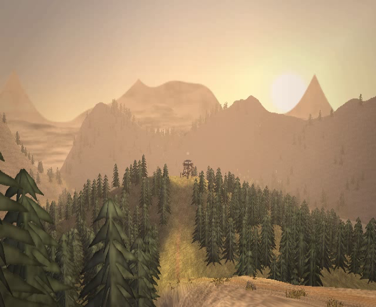
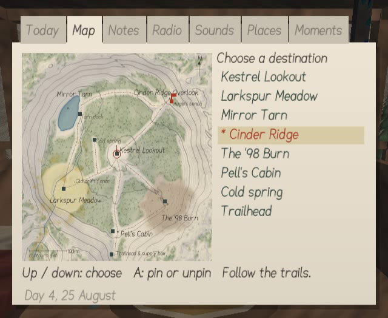
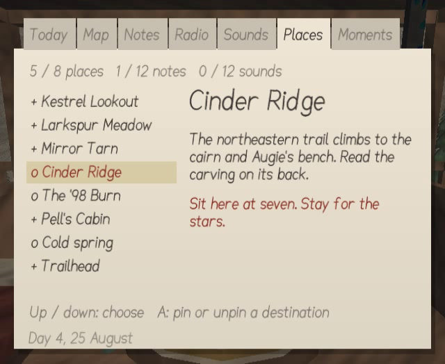
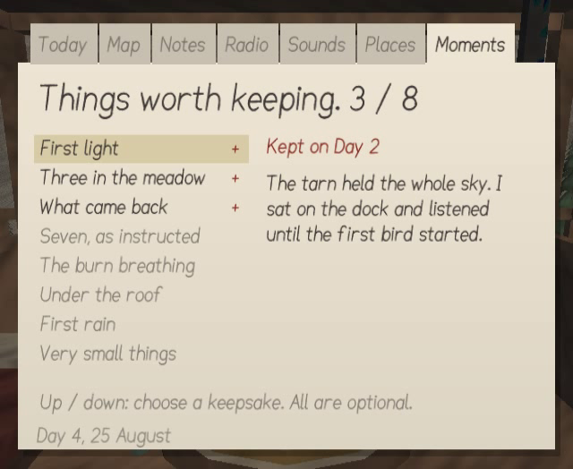

# 1.2: A season worth keeping

Exploration now gives the player more invitations, clearer feedback and a few pages of their
own. The story, its choices and the original Wii target are retained.

## Play

- **A field guide for eight places.** Short descriptions and time-of-day suggestions live in
  the notebook. Places are marked as visited, including the spring and trailhead.
- **Optional destinations.** Up/down selects a place on Map or Places. A pins it, or removes
  an existing pin. The view shows its bearing and straight-line distance. This is deliberately
  a compass bearing, not a route through the terrain; the map still shows the trails.
- **Eight keepsakes.** First light on the dock, the doe and fawns, the flower book, sunset on
  the ridge, wind through the burn, the dry storm, first rain, and the quiet after dark each
  have a personal notebook entry. The Moments page offers a hint until a moment is kept,
  then shows Theo's words and the day. No keepsake is required to finish.
- **Discovery feedback.** Places, notes, sounds, observations and moments get a short notice.
- **A gentler start.** The first day's next-step text points toward the lookout. Short control
  reminders appear at the start, and How to play is available on both title and pause menus.

## Comfort and reliability

- Film grain is off by default and can be switched back on. A narrower copy filter keeps
  the paper textures while making the image less blurred. Pollen, autumn particles, low
  dawn mist at the tarn and late-summer fireflies add movement with at most 112 triangles.
- The Radio page can scroll back through its retained history. Conversation pace can be set
  to Press A, so a line waits after its audio finishes.
- Autosaves run about every 90 seconds while walking or sitting between conversations.
  Save failures stay visible; a failed manual save keeps the pause menu open for retry.
- The new guide state is appended to the existing v1 save format. Original settings, story,
  radio state and 1.0/1.1 saves remain readable. The tests also check settings-only writes,
  failed SD writes and checksum rejection.
- Notes return to the notebook page they were opened from, even during its opening fade.
  The 2 button closes the notebook correctly. Afternoon readings before five no longer
  count as evening observations. The longer Options list scrolls inside the screen.
- Options reports how many recorded PCM lines were found on the SD card.

## Voices and development

The ElevenLabs tool prepares its own dialogue list. Its planning and packaging paths use
only the Python standard library, with no game build or image libraries required. A plan
can run before a key exists. Samples honour their spending limit, unknown call IDs fail
clearly, and an unavailable PCM format does not spend on MP3 before checking for ffmpeg.
The voice-only pack excludes local manifests and unfinished files.

`make test`, `make assets`, `make voice-plan`, `make voice-sample`, `make voices`, and
`make voice-pack` work without devkitPro. Normal Wii builds still require it.
`make REVIEW=1` builds a short screenshot tour of the new screens and atmosphere.

## Validation

- All **9,387 host checks passed**, including 60 randomised seasons, world traversal,
  audio synthesis, dialogue IDs, full game-save compatibility, field guide state and the
  voice generator against a fake API. A fresh-checkout subprocess uses Python's `-S` flag
  to verify that offline voice planning needs no installed packages.
- The release, screenshot, menu, Nunchuk walking and Remote-only walking variants compile
  and link with devkitPPC and libogc. The packaged DOL's section bounds and padding pass
  validation, and the ZIP contains only boot.dol, icon.png and meta.xml in the HBC layout.
- Actual Dolphin captures were reviewed for the title, clean ridge, dawn tarn, night tarn,
  destination notice, Map, Places, Moments, How to play and the scrolled Options screen.
  The screenshot pass caught and corrected tab and footer collisions.
- A complete scripted Dolphin menu test changed settings, saved to the virtual SD card,
  returned to the title, continued, and saved and quit. The resulting save has a valid
  checksum and guide extension. The recordings count was checked with a test PCM file.
- Emulator checks use a software Vulkan renderer with physical USB discovery disabled in
  the test environment. They are visual and functional checks, not a Wii performance
  benchmark. Physical Wii testing and live ElevenLabs generation remain to be done.

